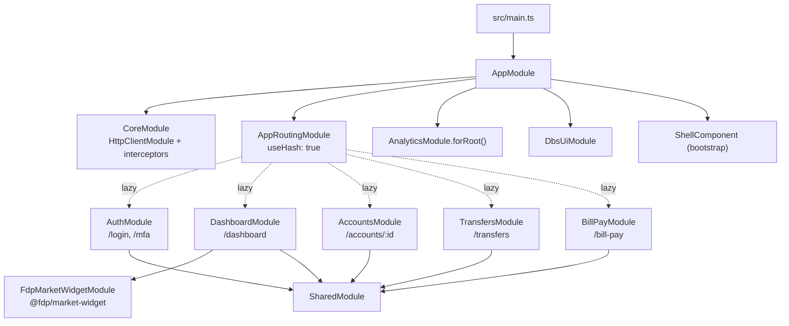

# Digital banking

The `digital-banking` project in `src/` is the customer-facing retail banking app: sign-in with MFA, an accounts dashboard, account detail, transfers, and bill pay. It is an NgModule-based Angular 14 app with hash URLs, lazy-loaded feature modules, and an in-browser mock backend so it runs with `ng serve` alone.

Active contributors: Deepak Sekar

## Purpose

This is the app that end users see and the main subject of the planned Angular 14 to 18 upgrade. It consumes both workspace libraries ([`@dbs-demo/ui`](../packages/ui.md) and [`@dbs-demo/analytics-sdk`](../packages/analytics-sdk.md)) and the vendored `@fdp/market-widget` package. Default ownership is `@dbs-demo/digital-banking-core`, with `@dbs-demo/appsec` co-owning `src/app/core/auth/` and `src/app/core/http/` (`.github/CODEOWNERS`).

## Directory layout

```
src/
  main.ts                     bootstraps AppModule
  index.html                  <app-root>, base href "/"
  styles.scss                 dbs-design-system() theme + self-hosted icon font
  environments/               environment.ts, environment.prod.ts
  assets/fonts/               material-icons.woff2
  app/
    app.module.ts             root NgModule
    app-routing.module.ts     root routes (hash URLs, lazy features)
    shell.component.ts        toolbar, sidenav, router-outlet
    core/                     singletons: CoreModule, auth, http, mock, services, models
    shared/shared.module.ts   module bundle imported by every feature module
    features/                 auth, dashboard, accounts, transfers, bill-pay
```

## Key abstractions

| Name | File | What it does |
| --- | --- | --- |
| `AppModule` | `src/app/app.module.ts` | Root module. Declares and bootstraps `ShellComponent`, imports `CoreModule`, `AppRoutingModule`, the Material modules the shell needs, `DbsUiModule`, and `AnalyticsModule.forRoot()`. Provides `DATE_PIPE_DEFAULT_TIMEZONE` as `-0500`. |
| `ShellComponent` | `src/app/shell.component.ts` | `app-root`. Renders the toolbar with a user menu (Sign out calls `AuthService.logout()`), a side nav that opens only when `auth.user$` emits a user, and the `<router-outlet>`. Uses `fxLayout` from `@angular/flex-layout`. |
| `AppRoutingModule` | `src/app/app-routing.module.ts` | Root routes with `useHash: true`, `relativeLinkResolution: 'legacy'`, `scrollPositionRestoration: 'enabled'`. |
| `CoreModule` | `src/app/core/core.module.ts` | Imports `HttpClientModule` and registers the HTTP interceptors. Throws `CoreModule is already loaded` if imported anywhere but `AppModule`. |
| `SharedModule` | `src/app/shared/shared.module.ts` | Imports and re-exports `CommonModule`, `ReactiveFormsModule`, `FlexLayoutModule`, 13 Material modules, `DbsUiModule`, and `AnalyticsModule` (without `forRoot`, so only `TrackDirective`). |
| `AuthGuard` | `src/app/core/auth/auth.guard.ts` | Class-based `CanActivate` and `CanLoad`. Redirects to `/login?returnUrl=...` when there is no session. |
| `MfaGuard` | `src/app/core/auth/mfa.guard.ts` | Class-based `CanActivate` on `/mfa`. |
| `environment` | `src/environments/environment.ts` | `production`, `useMockBackend`, `ssoUrl`, `ssoClientId`, `analyticsEndpoint`. |

## How it works

### Bootstrap

`src/main.ts` calls `enableProdMode()` when `environment.production` is true and then `platformBrowserDynamic().bootstrapModule(AppModule)`. `AppModule` bootstraps `ShellComponent` into the `<app-root>` element in `src/index.html`.

Both environment files set `useMockBackend: true`. The production file carries the comment that the demo build keeps the mock gateway on so the app is self-contained. The `production` build configuration in `angular.json` replaces `src/environments/environment.ts` with `src/environments/environment.prod.ts` and sets budgets of 1 MB warning / 2 MB error for the initial bundle and 4 KB / 8 KB per component stylesheet.

### Module graph



### Routes

| Path | Module | Guards / resolvers | Feature page |
| --- | --- | --- | --- |
| `''` (exact) | redirect to `dashboard` | | |
| `''` (children `login`, `mfa`) | `AuthModule` (`src/app/features/auth/auth.module.ts`) | `MfaGuard` on `mfa` | [Sign-in](../features/sign-in.md) |
| `dashboard` | `DashboardModule` (`src/app/features/dashboard/dashboard.module.ts`) | `AuthGuard` (`canLoad`, `canActivate`) | [Dashboard](../features/dashboard.md) |
| `accounts/:id` | `AccountsModule` (`src/app/features/accounts/accounts.module.ts`) | `AuthGuard`, `AccountResolver` | [Accounts](../features/accounts.md) |
| `transfers` | `TransfersModule` (`src/app/features/transfers/transfers.module.ts`) | `AuthGuard` | [Transfers](../features/transfers.md) |
| `bill-pay` | `BillPayModule` (`src/app/features/bill-pay/bill-pay.module.ts`) | `AuthGuard` | [Bill pay](../features/bill-pay.md) |
| `**` | redirect to `dashboard` | | |

`accounts` with no id redirects to `/dashboard`. Because `dashboard` is guarded, an unauthenticated visitor to `/` ends up at `/login?returnUrl=...`.

### Hash URLs

`RouterModule.forRoot(routes, { useHash: true, ... })` makes URLs look like `http://localhost:4200/#/dashboard`. The comment in `src/app/app-routing.module.ts` explains why: some embedded browsers, including the Factory desktop pane, do a full page reload on every `history.pushState`. A reload between `/login` and `/mfa` drops the SSO challenge that `AuthService` keeps only in memory, so path-based URLs broke sign-in there. Hash URLs avoid `pushState` reloads. This change was uncommitted at the time the wiki was written. See [Pitfalls](../background/pitfalls.md).

### HTTP interceptors

`CoreModule` builds its provider list at module load time:

1. `AuthInterceptor` (`src/app/core/http/auth.interceptor.ts`)
2. `ErrorInterceptor` (`src/app/core/http/error.interceptor.ts`)
3. `MockBackendInterceptor` (`src/app/core/mock/mock-backend.interceptor.ts`), only when `environment.useMockBackend` is true

`AnalyticsModule.forRoot()` adds `AnalyticsTimingInterceptor` after these, because `CoreModule` is imported before it in `AppModule`. The mock backend answers every `/api/` request itself without calling `next.handle()`, so with the mock enabled the timing interceptor does not see those requests. The full chain is described in [HTTP pipeline](../systems/http-pipeline.md) and the mock in [Mock backend](../systems/mock-backend.md).

### Styles

`src/styles.scss` loads the design-system theme from the built library (`@use '../dist/ui/theme/theme' as dbs; @include dbs.dbs-design-system();`), so the `ui` library must be built before the app compiles. It also declares a `@font-face` for Material Icons pointing at `/assets/fonts/material-icons.woff2`, replacing the Google Fonts link that was blocked in some environments, and defines global utility classes such as `.page`, `.grid`, `.form-card`, `.positive`, and `.negative`.

## Integration points

- **`@dbs-demo/ui`**: `DbsUiModule` components and pipes in templates, `DbsToastService` in `ErrorInterceptor` and `BillPayComponent`, and the theme mixin in `src/styles.scss`. See [UI library](../packages/ui.md).
- **`@dbs-demo/analytics-sdk`**: `AnalyticsModule.forRoot({ appId: 'digital-banking-web', endpoint: environment.analyticsEndpoint, debug: !environment.production })` in `AppModule`; `anTrack` attributes on the login, MFA, dashboard tile, transfer, and bill pay buttons; a direct `AnalyticsService.track('interaction', 'transfer_completed', ...)` call in `src/app/features/transfers/transfer.component.ts`. See [Analytics SDK](../packages/analytics-sdk.md).
- **`@fdp/market-widget`**: imported only by `DashboardModule`.
- **Backend**: all `/api/` calls go to the mock interceptor. The contract is in [API](../api.md).

## Upgrade-relevant patterns

These are deliberate Angular 14-era patterns that the upgrade policy gates. See [Upgrade gates](../background/upgrade-gates.md).

- Class-based guards (`AuthGuard`, `MfaGuard`) and class-based interceptors in `src/app/core/auth/` and `src/app/core/http/`. These files carry `@security-reviewed SEC-2291` headers (gate G3).
- `relativeLinkResolution: 'legacy'` in `src/app/app-routing.module.ts`, an option removed in later Angular versions.
- `CanLoad` on the lazy routes.
- `@angular/flex-layout` in `SharedModule` and the shell template (gate G2).
- `@fdp/market-widget` 3.4.2 with a peer range of `@angular/core >=13 <15` (gate G1).

## Entry points for modification

- **Add a feature page**: create a module under `src/app/features/<name>/` that imports `SharedModule` and `RouterModule.forChild(...)`, then add a lazy route with `canLoad` and `canActivate: [AuthGuard]` in `src/app/app-routing.module.ts` and a nav link in `src/app/shell.component.ts`.
- **Add a global provider**: `src/app/app.module.ts` for app-wide config, `src/app/core/core.module.ts` for HTTP interceptors.
- **Make a module available to all features**: add it to the `MODULES` array in `src/app/shared/shared.module.ts`.
- **Point at a real backend**: set `useMockBackend: false` in `src/environments/environment*.ts`.

Conventions for modules, services, and templates are in [Patterns and conventions](../how-to-contribute/patterns-and-conventions.md).

## Key source files

| File | Purpose |
| --- | --- |
| `src/main.ts` | Bootstraps `AppModule` |
| `src/index.html` | Host page with `<app-root>` |
| `src/app/app.module.ts` | Root module, analytics config, date pipe timezone |
| `src/app/shell.component.ts` | Toolbar, side nav, router outlet |
| `src/app/app-routing.module.ts` | Root routes, hash URLs, lazy modules, guards |
| `src/app/core/core.module.ts` | HTTP interceptor registration, single-import check |
| `src/app/shared/shared.module.ts` | Shared module bundle for features |
| `src/environments/environment.ts` | Development settings |
| `src/environments/environment.prod.ts` | Production settings (mock still on) |
| `src/styles.scss` | Global theme include, icon font, utility classes |
| `angular.json` | `digital-banking` build, serve, and test targets |
| `tsconfig.app.json` | App compilation entry files |
