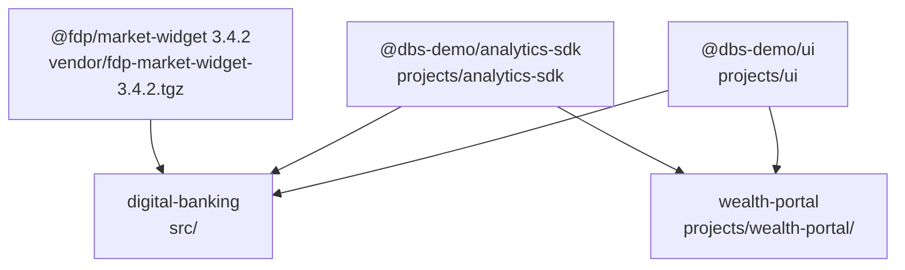

# Apps

The workspace ships two browser applications built with the Angular CLI browser builder. `digital-banking` is the retail banking app that most work targets, and `wealth-portal` is a small app owned by another team that exists mainly to prove the shared libraries still work for a downstream consumer.

## The two applications

| App | Source root | Root module | Root selector | Dev port | Build output | Owner (`.github/CODEOWNERS`) |
| --- | --- | --- | --- | --- | --- | --- |
| [digital-banking](digital-banking.md) | `src/` | `src/app/app.module.ts` | `app-root` | 4200 (CLI default) | `dist/digital-banking` | `@dbs-demo/digital-banking-core` |
| [wealth-portal](wealth-portal.md) | `projects/wealth-portal/src/` | `projects/wealth-portal/src/app/app.module.ts` | `wp-root` | 4300 | `dist/wealth-portal` | `@dbs-demo/wealth-frontend` |

Both are defined in `angular.json` with `build`, `serve`, `extract-i18n`, and `test` targets. Each has a `production` configuration (the default for `build`) that swaps in that project's `src/environments/environment.prod.ts`, and a `development` configuration (the default for `serve`).

## How they relate

The apps do not import each other. They share code only through the two libraries in `projects/`, which are compiled into `dist/` first and resolved through the `paths` entries in `tsconfig.json` (see [Packages](../packages/index.md)).

| Concern | digital-banking | wealth-portal |
| --- | --- | --- |
| Uses `DbsUiModule` and the `dbs-design-system()` theme | Yes | Yes |
| Calls `AnalyticsModule.forRoot()` | Yes, `appId: 'digital-banking-web'` | Yes, `appId: 'wealth-portal'` |
| Mock backend interceptor | Yes, `src/app/core/mock/mock-backend.interceptor.ts` | No |
| Routing | Hash URLs, five lazy feature modules | Path URLs, one eager route |
| Auth | SSO plus MFA step-up, guards | None |
| `@angular/flex-layout` | Yes, via `SharedModule` and the shell template | No |
| Self-hosted Material Icons font | `src/assets/fonts/material-icons.woff2` | `projects/wealth-portal/src/assets/fonts/material-icons.woff2` |

## Running and building

- `npm start` runs `prestart` (`npm run build:libs`) and then `ng serve digital-banking`.
- `npm run start:wealth` runs `ng serve wealth-portal`. It has no `prestart` hook, so the libraries must already be in `dist/` (run `npm run build:libs` or `npm start` once first).
- `npm run build` builds both libraries and then both apps.
- `npm test` runs Karma for each project in turn, including both apps.

See [Getting started](../overview/getting-started.md) for the full setup and [Architecture](../overview/architecture.md) for the build graph.

## Upgrade relevance

Both apps are in scope of the Angular upgrade policy. The wealth portal is code owned by another team (gate G5), and both apps consume the `@dbs-demo/ui` theme whose legacy `.mat-*` overrides fall under gate G4. See [Upgrade gates](../background/upgrade-gates.md).

## Key source files

| File | Purpose |
| --- | --- |
| `angular.json` | Defines the `digital-banking`, `wealth-portal`, `ui`, and `analytics-sdk` projects and their targets |
| `package.json` | `start`, `start:wealth`, `build`, `build:libs`, `test`, `verify` scripts |
| `tsconfig.json` | `paths` mapping for `@dbs-demo/ui` and `@dbs-demo/analytics-sdk` to `dist/` |
| `src/app/app.module.ts` | Root module of digital-banking |
| `projects/wealth-portal/src/app/app.module.ts` | Root module of wealth-portal |
| `.github/CODEOWNERS` | Team ownership per path |
