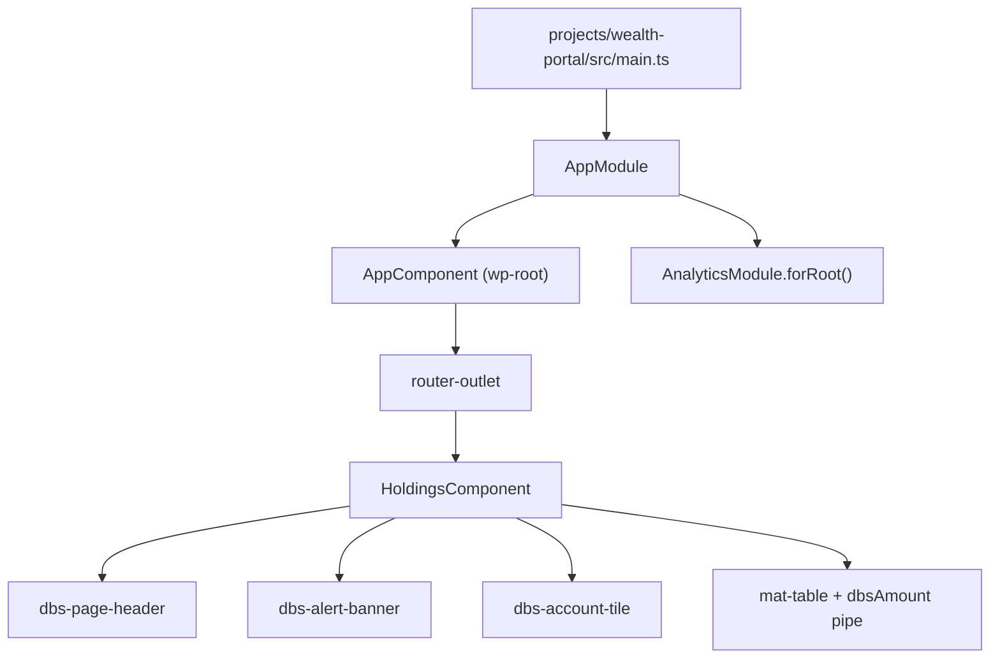

# Wealth portal

The `wealth-portal` project in `projects/wealth-portal/` is a one-page brokerage holdings app owned by a different team. Its job in this workspace is to be a downstream consumer of `@dbs-demo/ui`, so any change to the design system that breaks it shows up in the build and in its single spec.

Active contributors: Deepak Sekar

## Purpose

The comment on `AppModule` in `projects/wealth-portal/src/app/app.module.ts` states the intent: it is a downstream consumer of `@dbs-demo/ui` owned by the Wealth & Investments team, and its build must stay green through any design-system upgrade. `.github/CODEOWNERS` assigns `/projects/wealth-portal/` to `@dbs-demo/wealth-frontend`. Under the upgrade policy this is code owned by another team (gate G5), so only mechanical class A changes are allowed, in a separate commit, with that team as reviewers. See [Upgrade gates](../background/upgrade-gates.md).

## Directory layout

```
projects/wealth-portal/
  karma.conf.js, tsconfig.app.json, tsconfig.spec.json, .browserslistrc
  src/
    main.ts, index.html (<wp-root>), polyfills.ts, test.ts, styles.scss, favicon.ico
    environments/            environment.ts, environment.prod.ts ({ production } only)
    assets/fonts/            material-icons.woff2
    app/
      app.module.ts
      app.component.ts       wp-root shell
      app-routing.module.ts
      holdings.component.ts  the only page
      app.component.spec.ts  downstream contract test for HoldingsComponent
```

## Key abstractions

| Name | File | What it does |
| --- | --- | --- |
| `AppModule` | `projects/wealth-portal/src/app/app.module.ts` | Declares `AppComponent` and `HoldingsComponent`; imports `HttpClientModule`, `MatToolbarModule`, `MatTableModule`, `DbsUiModule`, and `AnalyticsModule.forRoot({ appId: 'wealth-portal', endpoint: '/api/analytics' })`. |
| `AppComponent` | `projects/wealth-portal/src/app/app.component.ts` | `wp-root`. A Material toolbar labelled "Wealth Portal" and "Downstream consumer of @dbs-demo/ui", plus a `<router-outlet>`. |
| `AppRoutingModule` | `projects/wealth-portal/src/app/app-routing.module.ts` | Two routes: `''` shows `HoldingsComponent`, `**` redirects to `''`. Uses path URLs with `relativeLinkResolution: 'legacy'`. |
| `HoldingsComponent` | `projects/wealth-portal/src/app/holdings.component.ts` | `wp-holdings`. Renders a `dbs-page-header`, a `dbs-alert-banner`, a `dbs-account-tile` for the brokerage total, and a `mat-table` of three hard-coded holdings using the `dbsAmount` pipe. |

## How it works



`HoldingsComponent` holds a static `holdings` array (VTI, AGG, D05) and a `total` getter that sums `shares * price`. There are no services and no HTTP calls of its own. The page header eyebrow reads "DBS Wealth (demo)".

The app registers `AnalyticsModule.forRoot()`, so `AnalyticsService` records a `page_view` on each `NavigationEnd` and posts the queue to `/api/analytics` every 10 seconds. Unlike digital-banking, the wealth portal has no mock backend interceptor, so under `ng serve` nothing answers that endpoint. See [Analytics SDK](../packages/analytics-sdk.md).

### Styles

`projects/wealth-portal/src/styles.scss` includes the design system from the built library (`@use '../../../dist/ui/theme/theme' as dbs; @include dbs.dbs-design-system();`), self-hosts the Material Icons font from `/assets/fonts/material-icons.woff2`, and then adds the wealth team's own overrides on Material's legacy table DOM:

```scss
.mat-table .mat-header-cell { color: #1a1a1a; font-weight: 600; text-transform: uppercase; font-size: 11px; letter-spacing: .04em; }
.mat-row:hover { background: #f2f2f2; }
```

These `.mat-table`, `.mat-header-cell`, and `.mat-row` selectors target legacy (non-MDC) Material class names. The Material 15 MDC migration renames them, so this stylesheet will silently stop applying unless it is updated. That touches both gate G4 (design-system visual change) and gate G5 (another team's code).

### The contract test

`projects/wealth-portal/src/app/app.component.spec.ts` is named for `AppComponent` but tests `HoldingsComponent` as "downstream contract with @dbs-demo/ui". It imports `DbsUiModule` and `MatTableModule` and asserts that:

- `dbs-page-header` contains "Portfolio holdings",
- there are exactly 3 `tr.mat-row` elements,
- the page text contains `new DbsAmountPipe().transform(total)`.

The `tr.mat-row` selector is a legacy Material class, so this test is one of the first things expected to fail under an MDC migration of the table.

## Integration points

- **`@dbs-demo/ui`**: `DbsUiModule`, `DbsAmountPipe`, and the `dbs-design-system()` mixin. See [UI library](../packages/ui.md).
- **`@dbs-demo/analytics-sdk`**: `AnalyticsModule.forRoot()` in `AppModule`.
- **Angular Material**: `MatToolbarModule`, `MatTableModule`.
- **Build**: `angular.json` project `wealth-portal`, output `dist/wealth-portal`, dev server port 4300, production config swaps `projects/wealth-portal/src/environments/environment.prod.ts`.

## Entry points for modification

- **Run it**: `npm run start:wealth` after the libraries are built (`npm run build:libs`). See [Getting started](../overview/getting-started.md).
- **Change the page**: `projects/wealth-portal/src/app/holdings.component.ts`.
- **Change table styling**: the override block at the end of `projects/wealth-portal/src/styles.scss`.
- **Check a design-system change against a consumer**: `ng test wealth-portal --watch=false --browsers=ChromeHeadlessCI` after rebuilding `ui`.

Any edit here needs review from `@dbs-demo/wealth-frontend`.

## Key source files

| File | Purpose |
| --- | --- |
| `projects/wealth-portal/src/main.ts` | Bootstraps `AppModule` |
| `projects/wealth-portal/src/index.html` | Host page with `<wp-root>` |
| `projects/wealth-portal/src/app/app.module.ts` | Root module, library imports, analytics config |
| `projects/wealth-portal/src/app/app.component.ts` | Toolbar shell |
| `projects/wealth-portal/src/app/app-routing.module.ts` | Single route |
| `projects/wealth-portal/src/app/holdings.component.ts` | Holdings page |
| `projects/wealth-portal/src/app/app.component.spec.ts` | Downstream contract test |
| `projects/wealth-portal/src/styles.scss` | Theme include, icon font, legacy table overrides |
| `projects/wealth-portal/src/environments/environment.ts` | `{ production: false }` |
| `angular.json` | `wealth-portal` targets, port 4300 |
