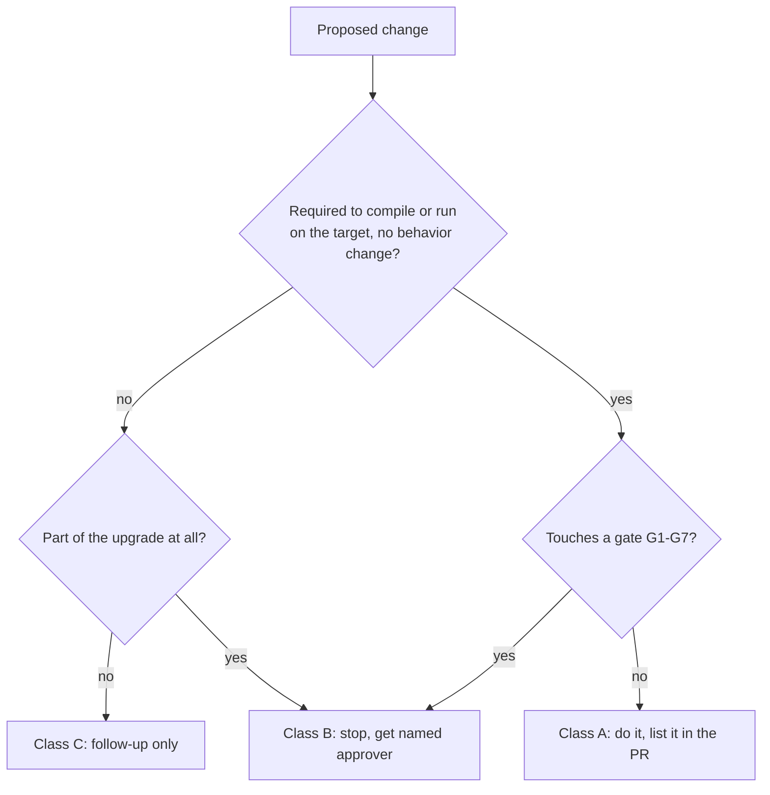
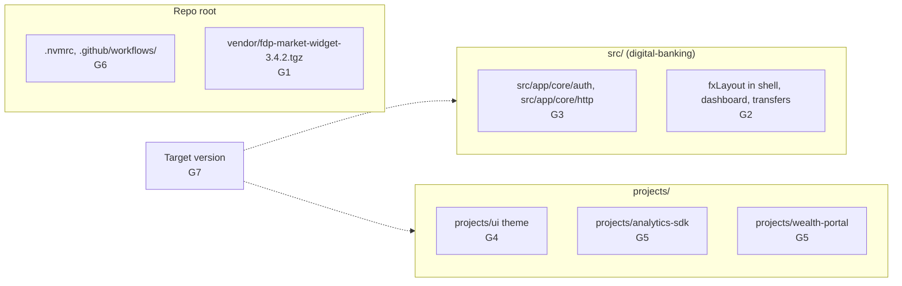

# Upgrade gates

`docs/engineering/frontend-upgrade-policy.md` sorts every upgrade change into class A, B or C and defines seven decision gates that need a named human approver. This page restates the policy and maps each gate to the code it protects in this repo.

The policy applies to every framework or dependency upgrade, "whether a person or an agent does it". Its owner is the Chief Architect's office, with security sign-offs from AppSec (Consumer Applications).

## Change classes

| Class | Covers | Who decides |
|---|---|---|
| A: Mechanical | Changes the framework requires to compile or run with no behavior change: `ng update` schematics, removed options (`relativeLinkResolution`, `entryComponents`), renamed tokens or APIs, TypeScript and zone.js bumps, test-config changes, internal `peerDependencies` ranges | The engineer or agent doing the upgrade; list them in the PR |
| B: Judgment | Anything touching a decision gate below | The named approver, before the change is made; the plan must include options and a recommendation |
| C: Out of scope | Unrelated refactors, new features, "while I'm here" clean-ups, style-only rewrites | Not done in an upgrade PR; noted as a follow-up |

Deprecated is not removed. A deprecated API that still works on the target version is not class A; it stays and goes on the Deferred list.

Note that G3 and G5 still allow class A changes inside the gated code, with extra conditions (see below).

## Decision gates

| Gate | Rule | Where it applies in this repo | Approver |
|---|---|---|---|
| G1 | Third-party package outside its vendor-supported range. Never patch, fork, or use `--force` / `--legacy-peer-deps` around a vendor package. | `@fdp/market-widget` 3.4.2 from `vendor/fdp-market-widget-3.4.2.tgz`, peer `@angular/core` and `@angular/common` `>=13.0.0 <15.0.0`. Running it on 15+ voids the vendor SLA (MSA section 7.3). | Vendor Management + AppSec |
| G2 | Dependency deprecated with no supported successor. | `@angular/flex-layout` (installed `14.0.0-beta.41`; the policy notes the last release is `15.0.0-beta.42`, nothing for 16+). Used in `src/app/shell.component.ts`, `src/app/features/dashboard/dashboard.component.html`, `src/app/features/transfers/transfer.component.html`, and exported from `src/app/shared/shared.module.ts`. | Chief Architect |
| G3 | Security-reviewed code (files with a `@security-reviewed` header). Class A allowed if behavior is identical and the PR calls it out; anything more, including class-to-functional guard or interceptor rewrites, needs a new AppSec review. | `src/app/core/auth/*` and `src/app/core/http/*`, review SEC-2291. | AppSec |
| G4 | Shared-library public API or visual change: anything that changes a downstream team's build, imports, SCSS mixin or rendered UI. Requires a major version bump of the library and notice to consumers. | `@dbs-demo/ui` theme: `dbs-design-system()` mixin and legacy `.mat-*` overrides in `projects/ui/src/lib/theme/_theme.scss`. The Material 15 MDC migration changes density, DOM and class names. | Design-system owner + Chief Architect |
| G5 | Code owned by another team (per `.github/CODEOWNERS`). Class A only, in a separate commit, with the owning team requested as reviewers. | `projects/analytics-sdk` (`@dbs-demo/analytics-platform`), `projects/wealth-portal` (`@dbs-demo/wealth-frontend`). | Owning team |
| G6 | Toolchain or platform change affecting shared build infrastructure. | Node 16 to 18/20. Angular 16+ needs Node 16.14+/18.x and 17+ needs 18.13+. `.nvmrc` and `.github/workflows/` belong to `@dbs-demo/platform-engineering`. | Platform Engineering |
| G7 | Target version must be supported on the date the upgrade ships. | The ticket says Angular 18, but the policy notes 18's LTS ended Nov 2025. | VP Engineering + Chief Architect |

The README's "Judgment calls built into this repo" table adds the reasoning per gate, for example that forcing the vendor widget onto Angular 15 "would probably work" but voids the SLA and violates the license (`node_modules/@fdp/market-widget/LICENSE.md` prohibits modification, redistribution and reverse engineering; `node_modules/@fdp/market-widget/README.md` cites MSA section 4.1 for "do not modify, patch or fork").

## Where each gate sits in the workspace

## Evidence required in every upgrade PR

From section 3 of the policy:

- `npm run verify` output showing every library and app builds and all tests pass, with no skipped or deleted tests.
- A smoke test of login, MFA, dashboard, account detail, transfer and bill pay, with screenshots.
- A Decisions table listing each gate touched, the option taken, and who approved it.
- A Deferred list of deprecated-but-working APIs and class C items, each with an owner.

Upgrade PRs are merged by a human with the required CODEOWNERS approvals. Agents never merge.

## Related pages

- [Pitfalls](pitfalls.md) for how G1, G2 and G6 show up as build problems today.
- [Cleanup opportunities](../cleanup-opportunities.md) for the deferred items and which gate governs each.
- [Security](../security.md) for what the G3 files do.
- [Dependencies](../reference/dependencies.md) for installed versions.

## Key source files

| File | Role |
|---|---|
| `docs/engineering/frontend-upgrade-policy.md` | The policy itself |
| `README.md` | Upgrade surface and judgment-call tables |
| `.github/CODEOWNERS` | Team ownership used by G3, G5, G6 |
| `node_modules/@fdp/market-widget/README.md` | Vendor support range and MSA terms |
| `node_modules/@fdp/market-widget/LICENSE.md` | Commercial license terms |
