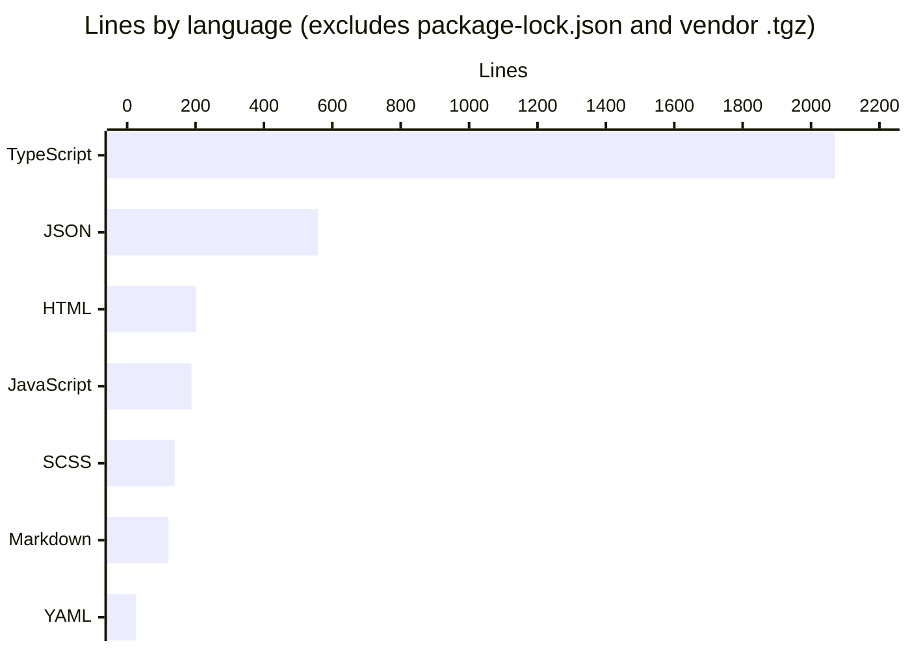

# By the numbers

Data collected on 2026-10-09.

This page measures the size, shape and history of the workspace using `git ls-files`, `wc -l` and `rg`. The repo is small (115 tracked files, about 3,300 lines of hand-written text) because it is a synthetic demo built to be the subject of an Angular 14 to 18 upgrade, as described in [the overview](overview/index.md).

## Method

- File list: `git ls-files` (115 tracked files at `041fc80`).
- Lines of code exclude `package-lock.json` (21,901 lines) and the vendored binary `vendor/fdp-market-widget-3.4.2.tgz`, leaving 113 files.
- Lines are physical lines (`wc -l`), including blanks and comments.
- Uncommitted working-tree changes (see [lore](lore.md)) and the generated `droid-wiki/` folder are not counted.

## Lines of code by language

| Language | Files | Lines | Notes |
|---|---|---|---|
| TypeScript | 67 | 2,070 | Components, services, modules, specs, environments, polyfills |
| JSON | 17 | 558 | `angular.json` alone is 271 lines; also tsconfigs, ng-package.json files, library package.json files |
| HTML | 6 | 202 | External templates; most components use inline templates |
| JavaScript | 4 | 188 | The four Karma configs (`karma.conf.js` plus one per project) |
| SCSS | 4 | 139 | `src/styles.scss`, `projects/wealth-portal/src/styles.scss`, the design-system theme, the dashboard override |
| Markdown | 4 | 121 | `README.md`, the upgrade policy, two library READMEs |
| YAML | 1 | 26 | `.github/workflows/ci.yml` |

The remaining tracked files are small dotfiles (`.editorconfig`, `.nvmrc`, `.gitignore`, two `.browserslistrc`, `.github/CODEOWNERS`), two `favicon.ico` files and two `.gitkeep` placeholders.

## Source, test and config files

| Category | Files | Lines | What is included |
|---|---|---|---|
| Source | 62 | 2,095 | 52 TypeScript, 6 HTML, 4 SCSS files under `src/` and `projects/*/src/` |
| Test | 11 | 282 | 7 `*.spec.ts` files plus 4 Karma bootstrap files (`src/test.ts`, `projects/*/src/test.ts`) |
| Config | 32 | 910 | `angular.json`, `package.json`, tsconfigs, Karma configs, ng-package.json files, environments, CI, CODEOWNERS, dotfiles |
| Docs | 4 | 121 | Markdown files |
| Assets | 4 | 14 | Favicons and `.gitkeep` files |

Environment files (`src/environments/*.ts`, `projects/wealth-portal/src/environments/*.ts`) are counted as config.

## Files per project

| Area | Path | Tracked files |
|---|---|---|
| digital-banking (retail app) | `src/` | 46 |
| `@dbs-demo/ui` library | `projects/ui/` | 20 |
| wealth-portal (downstream app) | `projects/wealth-portal/` | 18 |
| `@dbs-demo/analytics-sdk` library | `projects/analytics-sdk/` | 15 |
| Workspace root | `/` | 12 (including `package-lock.json`) |
| CI and ownership | `.github/` | 2 |
| Engineering docs | `docs/` | 1 |
| Vendored package | `vendor/` | 1 (`vendor/fdp-market-widget-3.4.2.tgz`) |

See [apps](apps/index.md) and [packages](packages/index.md) for what each project does.

## Test-to-code ratio

| Measure | Value |
|---|---|
| Spec files | 7 |
| Test cases (`it(...)` blocks) | 17 |
| Spec lines | 176 |
| Source TypeScript lines (non-test, non-environment) | 1,754 in 52 files |
| Spec lines per source line | 0.10 (about 1 line of spec per 10 lines of source) |
| Spec files per source TypeScript file | 7 / 52 (13%) |

Test cases by project:

| Project | Spec files | Test cases |
|---|---|---|
| `ui` | `projects/ui/src/lib/pipes/amount.pipe.spec.ts`, `projects/ui/src/lib/pipes/mask.pipe.spec.ts` | 7 |
| `analytics-sdk` | `projects/analytics-sdk/src/lib/analytics.service.spec.ts` | 2 |
| `digital-banking` | `src/app/core/auth/auth.guard.spec.ts`, `src/app/features/accounts/account-detail.component.spec.ts`, `src/app/features/transfers/transfer.validators.spec.ts` | 7 |
| `wealth-portal` | `projects/wealth-portal/src/app/app.component.spec.ts` | 1 |

The digital-banking specs test pure functions and a guard (`filterTransactions`, `transferValidator`, `AuthGuard`). No feature component is rendered in a test, and there are no end-to-end tests. See [testing](how-to-contribute/testing.md).

## Activity

| Measure | Value |
|---|---|
| Total commits | 2 |
| First commit | `e513073`, 2026-10-09 15:12 (-0700), 115 files, 25,263 insertions |
| Latest commit | `041fc80`, 2026-10-09 15:16 (-0700), 41 files, 162 insertions and 162 deletions |
| Active days | 1 (2026-10-09) |
| Time between first and last commit | 4 minutes |
| Branches | `main` |

Both commits landed on the same afternoon, so there is no meaningful trend over time yet. The history of how the code got here is in [lore](lore.md).

## Bot-attributed commits

| Measure | Value |
|---|---|
| Commits with `Co-authored-by: factory-droid[bot]` | 2 of 2 (100%) |

## Complexity

The code is spread thinly. No hand-written file exceeds 135 lines, and the largest file overall is configuration.

### Largest files

| File | Lines | What it is |
|---|---|---|
| `angular.json` | 271 | Workspace config for all four projects |
| `src/app/core/mock/mock-backend.interceptor.ts` | 132 | In-browser mock of every backend route ([mock backend](systems/mock-backend.md)) |
| `src/app/core/models.ts` | 90 | Shared data types ([data models](reference/data-models.md)) |
| `src/app/features/transfers/transfer.component.ts` | 85 | Transfer form and confirmation ([transfers](features/transfers.md)) |
| `src/app/core/auth/auth.service.ts` | 73 | SSO challenge, MFA verify, session storage ([sign-in](features/sign-in.md)) |
| `README.md` | 69 | Workspace README and upgrade surface table |
| `src/app/features/bill-pay/bill-pay.component.ts` | 63 | Bill pay feature |
| `src/app/features/auth/login.component.ts` | 62 | Login form |
| `projects/analytics-sdk/src/lib/analytics.service.ts` | 62 | Analytics queue, flush and redaction |
| `projects/ui/src/lib/theme/_theme.scss` | 61 | `dbs-design-system()` theme mixin |

### Average file size by directory

| Directory | Files | Lines | Average lines per file |
|---|---|---|---|
| Workspace root (excluding `package-lock.json`) | 11 | 589 | 53.5 |
| `src/app/core/` | 14 | 570 | 40.7 |
| `src/app/features/` | 19 | 651 | 34.3 |
| `projects/analytics-sdk/src/` | 8 | 223 | 27.9 |
| `projects/ui/src/` | 13 | 355 | 27.3 |
| `projects/wealth-portal/src/` | 14 | 295 | 21.1 |
| `src/environments/` | 2 | 15 | 7.5 |

`src/app/shared/` holds a single file, `src/app/shared/shared.module.ts` (46 lines).
