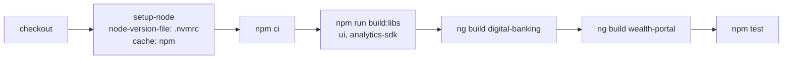

# Deployment

The repo has no deployment pipeline. It has one CI workflow that builds every project and runs every test suite, and production builds produce static bundles under `dist/` that are never published anywhere by the repo.

## CI workflow

`.github/workflows/ci.yml` defines one job, `verify` ("Build & test (libs + all consumers)"), triggered on every pull request and on pushes to `main`. It runs on `ubuntu-latest`.

| Step | Command | Notes |
|---|---|---|
| Node setup | `actions/setup-node@v4` with `node-version-file: .nvmrc` | `.nvmrc` contains `16` |
| Install | `npm ci` | Uses `package-lock.json` exactly |
| Build shared libraries | `npm run build:libs` | `ng build ui && ng build analytics-sdk` |
| Build retail app | `npx ng build digital-banking` | Production configuration (the default) |
| Build downstream consumer | `npx ng build wealth-portal` | Proves `@dbs-demo/ui` changes do not break another team |
| Unit tests | `npm test` | Karma, `ChromeHeadlessCI`, each project in turn |

The workflow is the CI equivalent of `npm run verify` (build plus test), which the policy in `docs/engineering/frontend-upgrade-policy.md` requires as evidence in every upgrade PR. `/.github/workflows/` and `/.nvmrc` are owned by `@dbs-demo/platform-engineering` in `.github/CODEOWNERS`, which is why a Node version change is gate G6 (see [upgrade gates](background/upgrade-gates.md)). Test details are in [testing](how-to-contribute/testing.md).

## Build outputs

All output goes to `dist/`, which is ignored by `.gitignore`.

| Project | Builder | Output |
|---|---|---|
| `ui` | `@angular-devkit/build-angular:ng-packagr` | `dist/ui` (partial compilation, plus `theme/**/*.scss` copied from `projects/ui/src/lib/theme`) |
| `analytics-sdk` | `@angular-devkit/build-angular:ng-packagr` | `dist/analytics-sdk` |
| `digital-banking` | `@angular-devkit/build-angular:browser` | `dist/digital-banking` |
| `wealth-portal` | `@angular-devkit/build-angular:browser` | `dist/wealth-portal` |

The apps resolve `@dbs-demo/ui` and `@dbs-demo/analytics-sdk` through `tsconfig.json` `paths` that point at `dist/ui` and `dist/analytics-sdk`, so the libraries must be built first. See [packages](packages/index.md) and [configuration](reference/configuration.md).

Production builds of both apps, configured in `angular.json`, use:

- `fileReplacements` that swap `src/environments/environment.ts` for `src/environments/environment.prod.ts` (the wealth portal has the same pair under `projects/wealth-portal/src/environments/`).
- `outputHashing: "all"`.
- Budgets: initial bundle warns at 1 MB and fails at 2 MB; any component style warns at 4 KB and fails at 8 KB.

The libraries are not published to a registry. `projects/ui/package.json` declares version `4.2.0` and `projects/analytics-sdk/package.json` declares `2.7.1`, but within this repo they are only consumed through the path mapping.

## Environments

| File | `production` | `useMockBackend` | Other values |
|---|---|---|---|
| `src/environments/environment.ts` | `false` | `true` | `ssoUrl: '/api/sso'`, `ssoClientId: 'digital-banking-web'`, `analyticsEndpoint: '/api/analytics'` |
| `src/environments/environment.prod.ts` | `true` | `true` | Same as above |
| `projects/wealth-portal/src/environments/environment.ts` | `false` | n/a | none |
| `projects/wealth-portal/src/environments/environment.prod.ts` | `true` | n/a | none |

`src/environments/environment.prod.ts` keeps the mock backend on by design ("Demo build: the mock gateway stays on so the app is fully self-contained"). A production bundle therefore runs without a server, and it also contains the demo credentials. See [mock backend](systems/mock-backend.md) and [security](security.md).

## Hosting notes

Because the app uses hash URLs (`useHash: true` in `src/app/app-routing.module.ts`), `dist/digital-banking` can be served by any static file server without rewrite rules for deep links. `wealth-portal` uses path URLs (`projects/wealth-portal/src/app/app-routing.module.ts` has no `useHash`), but it only has a single route. Both apps' `index.html` files (`src/index.html`, `projects/wealth-portal/src/index.html`) use `<base href="/">`, so they expect to be served from the site root.

## Key source files

| File | Role |
|---|---|
| `.github/workflows/ci.yml` | The only CI workflow |
| `package.json` | `build:libs`, `build`, `test`, `verify` scripts |
| `angular.json` | Builders, output paths, budgets, file replacements |
| `tsconfig.json` | `paths` mapping to `dist/` |
| `src/environments/environment.prod.ts` | Production environment for digital-banking |
| `.nvmrc` | Node version used by CI |
