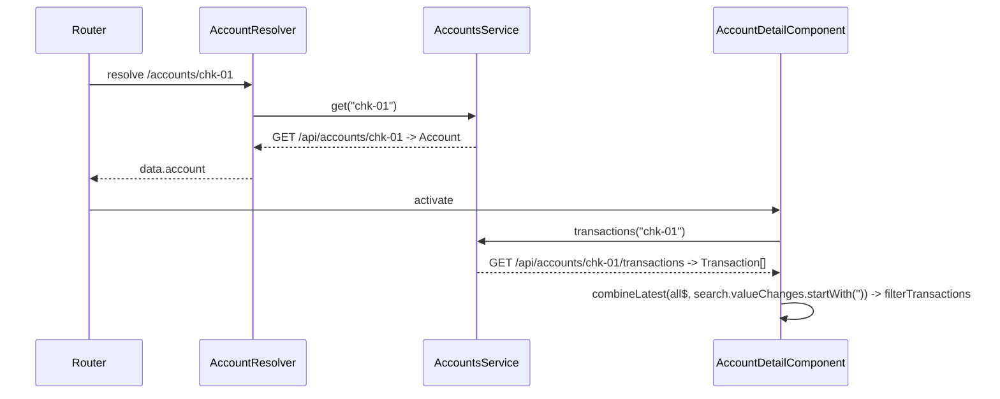

# Accounts

The accounts feature is the account detail page at `/accounts/:id`. A route resolver loads the account before the page renders, and the page shows balances plus a searchable transaction table.

Active contributors: Deepak Sekar

## Purpose

Show one account's current and available balance and its recent activity, and offer a shortcut into [Transfers](transfers.md) with that account preselected. Users reach it by clicking an account tile on the [Dashboard](dashboard.md).

## Directory layout

```
src/app/features/accounts/
  accounts.module.ts                 routes ':id' (resolver) and '' -> /dashboard
  account-detail.component.ts        component + exported filterTransactions()
  account-detail.component.html      header, summary, tabs, mat-table
  account-detail.component.spec.ts   filterTransactions tests
src/app/core/services/
  account.resolver.ts                Resolve<Account>
  accounts.service.ts                get(id), transactions(id)
```

## Key abstractions

| Name | File | Role |
|---|---|---|
| `AccountResolver` | `src/app/core/services/account.resolver.ts` | Class-based `Resolve<Account>`; calls `AccountsService.get(route.paramMap.get('id') ?? '')` |
| `AccountDetailComponent` | `src/app/features/accounts/account-detail.component.ts` | Reads `route.snapshot.data['account']`, loads transactions, combines them with the search box |
| `filterTransactions(txns, query)` | `src/app/features/accounts/account-detail.component.ts` | Pure function: trims and lowercases the query, returns all rows for an empty query, otherwise rows whose `description` or `category` contains it |
| `Account`, `Transaction` | `src/app/core/models.ts` | Data shapes (see [Data models](../reference/data-models.md)) |

## How it works



1. The child routes in `src/app/features/accounts/accounts.module.ts` are `:id` with `resolve: { account: AccountResolver }`, and `''` which redirects to `/dashboard`. The parent `accounts` route is protected by `AuthGuard`.
2. If `GET /api/accounts/:id` fails (the mock returns 404 `not_found` for unknown ids), the resolver errors and navigation is cancelled. No custom error handling exists for that case.
3. `ngOnInit` takes the resolved account from the route snapshot, subscribes to `AccountsService.transactions(id)` and pushes the result into a `BehaviorSubject`. `filtered$` combines that subject with the `search` control's value changes.
4. The template shows `dbs-page-header` with the account kind as eyebrow, the name as title and `account.number | dbsMask` in the subtitle. A "Transfer from this account" button links to `/transfers` with `queryParams: { from: account.id }`.
5. The Activity tab renders a `mat-table` with columns `date` (`MMM d, y`), `description` (with a PENDING tag when `pending`), `category`, and `amount` (`dbsAmount: true`, with a `positive` class for credits). The Statements tab is static text.

The mock generates 18 transactions per account in `buildTransactions()` in `src/app/core/mock/mock-data.ts`. The first two per account are `pending: true`, and credit-card amounts are forced negative. Transfers made in the session prepend two pending rows (see [Transfers](transfers.md)).

## Integration points

- [Dashboard](dashboard.md) navigates here via `router.navigate(['/accounts', id])`.
- [Transfers](transfers.md) reads the `from` query parameter to preselect the source account.
- Pipes `dbsMask` and `dbsAmount` come from [`@dbs-demo/ui`](../packages/ui.md).
- Requests go through [the HTTP pipeline](../systems/http-pipeline.md) and are answered by [the mock backend](../systems/mock-backend.md).

## Entry points for modification

- Search behavior: `filterTransactions()` in `src/app/features/accounts/account-detail.component.ts`, with tests in `src/app/features/accounts/account-detail.component.spec.ts`.
- Table columns: `columns` in the component and the `matColumnDef` blocks in `src/app/features/accounts/account-detail.component.html`.
- Resolver behavior (for example, redirecting on 404): `src/app/core/services/account.resolver.ts`.

## Key source files

| File | Purpose |
|---|---|
| `src/app/features/accounts/accounts.module.ts` | Routes and resolver binding |
| `src/app/features/accounts/account-detail.component.ts` | Component logic and `filterTransactions()` |
| `src/app/features/accounts/account-detail.component.html` | Summary, tabs, transaction table |
| `src/app/features/accounts/account-detail.component.spec.ts` | Filter tests |
| `src/app/core/services/account.resolver.ts` | Loads the account before activation |
| `src/app/core/services/accounts.service.ts` | Account and transaction requests |
| `src/app/core/mock/mock-data.ts` | Mock accounts and generated transactions |
