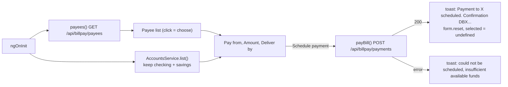

# Bill pay

The bill pay feature (`/bill-pay`) lets the user pick a saved payee, choose a checking or savings account, and schedule a one-time payment. Results are reported with a toast from `DbsToastService` instead of an inline confirmation.

Active contributors: Deepak Sekar

## Purpose

Schedule payments to the payees returned by `GET /api/billpay/payees`. Unlike [Transfers](transfers.md), there is no custom group validator and no confirmation screen.

## Directory layout

```
src/app/features/bill-pay/
  bill-pay.module.ts           route ''
  bill-pay.component.ts        payee selection, form, pay()
  bill-pay.component.html      two-column layout: payee list, payment form
```

## Key abstractions

| Name | File | Role |
|---|---|---|
| `BillPayComponent` | `src/app/features/bill-pay/bill-pay.component.ts` | Loads payees and eligible accounts, tracks `selected` payee, submits payments |
| `PaymentsService.payees()` | `src/app/core/services/payments.service.ts` | `GET /api/billpay/payees` returns `Payee[]` |
| `PaymentsService.payBill()` | `src/app/core/services/payments.service.ts` | `POST /api/billpay/payments` with a `BillPayment`, returns `Confirmation` |
| `DbsToastService` | `@dbs-demo/ui` (see [UI library](../packages/ui.md)) | Shows success and failure messages |
| `Payee`, `BillPayment`, `Confirmation` | `src/app/core/models.ts` | Data shapes |

## How it works



- **Payees.** The left card lists each payee with `category` and `accountNumber | dbsMask`. Clicking calls `choose(p)`, which sets `selected` and shows a check icon.
- **Form.** `fromAccountId` (required), `amount` (required, `min(1)`), `deliverBy` (required, datepicker `min` is today). The submit button is disabled until a payee is selected. If the form is invalid, `pay()` marks all fields touched and returns. The template has no `mat-error` messages for these fields.
- **Eligible accounts.** Only accounts with `kind === 'checking'` or `'savings'` appear in "Pay from".
- **Submit.** `pay()` posts `{ payeeId, fromAccountId, amount: Number(amount), deliverBy: toISOString() }`. On success the toast reads "Payment to <name> scheduled. Confirmation <number>." and the form and selection reset. On any error the toast reads "Payment could not be scheduled — insufficient available funds." regardless of the actual error code.

### Mock behavior

The mock returns the four payees in `MOCK_PAYEES` (`src/app/core/mock/mock-data.ts`): Con Edison, Verizon Wireless, GEICO Auto Insurance and Chase Sapphire. For payments it returns 422 `insufficient_funds` when the source account is unknown, `amount <= 0`, or `amount > available`. Otherwise it returns `{ confirmationNumber, status: 'scheduled' }`. Unlike transfers, the mock does not change any balances or add transactions for bill payments. See [Mock backend](../systems/mock-backend.md).

## Integration points

- Reached from the sidenav link "Bill pay" in `src/app/shell.component.ts`.
- `DbsToastService` and `dbsMask` come from [`@dbs-demo/ui`](../packages/ui.md). `DbsToastService` is the same service `ErrorInterceptor` uses for session and server error toasts (see [HTTP pipeline](../systems/http-pipeline.md)).
- The submit button carries `anTrack="billpay_submit"`.
- Endpoint contract in [API](../api.md).

## Entry points for modification

- Form fields and validation: the `form` group in `src/app/features/bill-pay/bill-pay.component.ts` and `src/app/features/bill-pay/bill-pay.component.html`.
- Error messaging per error code: the `error` callback in `pay()`.
- Payee data: `MOCK_PAYEES` in `src/app/core/mock/mock-data.ts`.

## Key source files

| File | Purpose |
|---|---|
| `src/app/features/bill-pay/bill-pay.module.ts` | Route |
| `src/app/features/bill-pay/bill-pay.component.ts` | Component logic and toasts |
| `src/app/features/bill-pay/bill-pay.component.html` | Payee list and payment form |
| `src/app/core/services/payments.service.ts` | `payees()` and `payBill()` |
| `src/app/core/mock/mock-data.ts` | `MOCK_PAYEES` |
| `src/app/core/mock/mock-backend.interceptor.ts` | Mock payment validation |
