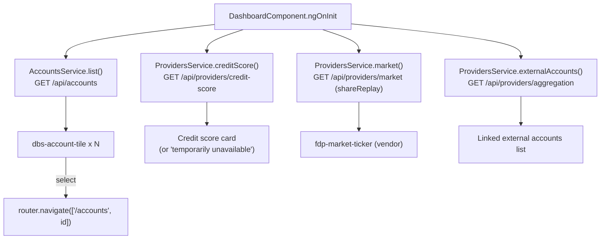

# Dashboard

The dashboard (`/dashboard`, titled "Accounts overview") is the landing page after sign-in. It shows a greeting, a dismissible notice, one tile per account, and three widgets: credit score, a market ticker rendered by the vendored `@fdp/market-widget`, and linked external accounts.

Active contributors: Deepak Sekar

## Purpose

Give the signed-in user a single view of their own accounts plus third-party data (credit bureau, market data, account aggregation), and route them into [account detail](accounts.md).

## Directory layout

```
src/app/features/dashboard/
  dashboard.module.ts         imports SharedModule + FdpMarketWidgetModule, route ''
  dashboard.component.ts      wires four observables in ngOnInit
  dashboard.component.html    header, banner, tiles, widgets
  dashboard.component.scss    score, quote rows, legacy .mat-chip override
```

## Key abstractions

| Name | File | Role |
|---|---|---|
| `DashboardComponent` | `src/app/features/dashboard/dashboard.component.ts` | Exposes `accounts$`, `creditScore$`, `market$`, `external$`, `showBanner`; `open(account)` navigates to `/accounts/:id` |
| `AccountsService.list()` | `src/app/core/services/accounts.service.ts` | `GET /api/accounts` |
| `ProvidersService` | `src/app/core/services/providers.service.ts` | `creditScore()`, `market()`, `externalAccounts()`; each swallows errors |
| `FdpMarketTickerComponent` | `node_modules/@fdp/market-widget/lib/market-ticker.component.d.ts` | Vendor `<fdp-market-ticker>` with inputs `quotes` and `delayed` |
| `DbsAccountTileComponent` | `projects/ui/src/lib` (see [UI library](../packages/ui.md)) | `<dbs-account-tile>` with `name`, `accountNumber`, `balance`, `kind` inputs and a `select` output |

## How it works



- **Greeting.** `dbs-page-header` shows "Good afternoon, " plus the first name from `auth.user$`. The greeting is fixed text, not time-based.
- **Banner.** A warning-level `dbs-alert-banner` about paperless statements. Dismissing sets `showBanner = false` for the life of the component only.
- **Account tiles.** The grid renders `accounts$ | async` with `trackBy: trackById`, and shows a `mat-spinner` until data arrives. Each tile has `anTrack="account_tile_open"` with `[anTrackProps]="{ kind: a.kind }"`. Clicking a tile calls `open(a)`.
- **Credit score.** Renders the score, a `mat-chip` with the band, and `provider` plus `asOf | date: 'mediumDate'`. `creditScore()` maps any error to `null`, which shows "Credit score is temporarily unavailable."
- **Markets.** `<fdp-market-ticker [quotes]="market$ | async">`. `ProvidersService.market()` caches its observable in a field with `??=` and `shareReplay(1)`, so the request runs once per service instance (the service is `providedIn: 'root'`). Errors become `[]`.
- **Linked external accounts.** Lists `institution · name ••mask` and `balance | dbsAmount`. Errors become `[]`, so the card is simply empty on failure.
- Layout of the three widget cards uses `@angular/flex-layout` directives (`fxLayout="row wrap"`, `fxLayout.lt-md="column"`, `fxFlex`).

## Vendor market widget

`@fdp/market-widget` 3.4.2 is installed from `vendor/fdp-market-widget-3.4.2.tgz` (`"file:vendor/fdp-market-widget-3.4.2.tgz"` in `package.json`) and imported as `FdpMarketWidgetModule` in `src/app/features/dashboard/dashboard.module.ts`. Its `README.md` states:

- Supported Angular versions are 13.x to 14.x. Angular 16+ support (v4.0) is on the vendor roadmap with no committed date.
- Running it on an unsupported Angular version voids the vendor support SLA (MSA section 7.3).
- Do not modify, patch or fork the package (MSA section 4.1). Upgrades go through Vendor Management.

Its `package.json` declares peer dependencies `@angular/core` and `@angular/common` `>=13.0.0 <15.0.0`. This is upgrade gate G1 (see [Upgrade gates](../background/upgrade-gates.md)). The component's `FdpQuote` input type matches `MarketQuote` in `src/app/core/models.ts` field for field (`symbol`, `name`, `price`, `change`).

## Integration points

- Data comes from [the mock backend](../systems/mock-backend.md) through [the HTTP pipeline](../systems/http-pipeline.md). Provider endpoints are listed in [API](../api.md).
- `src/app/features/dashboard/dashboard.component.scss` overrides `.mat-chip.mat-standard-chip.mat-chip-selected.mat-primary` with `::ng-deep`. That selector belongs to legacy (pre-MDC) Material and is part of the G4 theming work.
- Tiles link to [Accounts](accounts.md).

## Entry points for modification

- Add or change a widget: `src/app/features/dashboard/dashboard.component.html` and a new method on `ProvidersService`.
- Change provider error handling: `src/app/core/services/providers.service.ts`.
- Change mock data shown here: the `/api/providers/*` branches and `MOCK_ACCOUNTS` (see [Mock backend](../systems/mock-backend.md)).
- Do not edit anything under `node_modules/@fdp/market-widget` or the tarball in `vendor/`.

## Key source files

| File | Purpose |
|---|---|
| `src/app/features/dashboard/dashboard.module.ts` | Route and `FdpMarketWidgetModule` import |
| `src/app/features/dashboard/dashboard.component.ts` | Observables and tile navigation |
| `src/app/features/dashboard/dashboard.component.html` | Page layout and widgets |
| `src/app/features/dashboard/dashboard.component.scss` | Widget styles and legacy chip override |
| `src/app/core/services/providers.service.ts` | Credit score, market, aggregation calls |
| `src/app/core/services/accounts.service.ts` | Account list call |
| `vendor/fdp-market-widget-3.4.2.tgz` | Vendored market ticker package |
