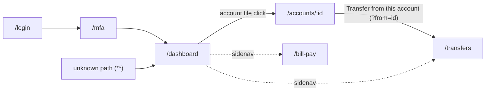

# Features

The `digital-banking` app has five user-facing features, each a lazy-loaded NgModule under `src/app/features/`. Every feature except sign-in sits behind `AuthGuard` and reads data through the services in `src/app/core/services/`, which the [mock backend](../systems/mock-backend.md) answers in the browser.

Active contributors: Deepak Sekar

## Feature map

| Feature | Route(s) | Module | Main component | Data sources |
|---|---|---|---|---|
| [Sign-in](sign-in.md) | `/login`, `/mfa` | `src/app/features/auth/auth.module.ts` | `LoginComponent`, `MfaComponent` | `AuthService` (`/api/sso/*`) |
| [Dashboard](dashboard.md) | `/dashboard` | `src/app/features/dashboard/dashboard.module.ts` | `DashboardComponent` | `AccountsService`, `ProvidersService` |
| [Accounts](accounts.md) | `/accounts/:id` | `src/app/features/accounts/accounts.module.ts` | `AccountDetailComponent` | `AccountResolver`, `AccountsService` |
| [Transfers](transfers.md) | `/transfers` | `src/app/features/transfers/transfers.module.ts` | `TransferComponent` | `AccountsService`, `PaymentsService` |
| [Bill pay](bill-pay.md) | `/bill-pay` | `src/app/features/bill-pay/bill-pay.module.ts` | `BillPayComponent` | `PaymentsService`, `AccountsService` |

All routes are defined in `src/app/app-routing.module.ts`. The router uses hash URLs (`useHash: true`), so in a browser the paths appear as `/#/dashboard`, `/#/login?returnUrl=...` and so on. See [Sign-in](sign-in.md#why-hash-urls) for the reason.

## Navigation between features

The sidenav in `src/app/shell.component.ts` links to Accounts overview (`/dashboard`), Transfer money (`/transfers`) and Bill pay (`/bill-pay`). It opens only when `AuthService.user$` emits a user. The toolbar user menu has a Sign out button that calls `AuthService.logout()`.

## Shared building blocks

Each feature module imports `SharedModule` (`src/app/shared/shared.module.ts`), which re-exports `CommonModule`, `ReactiveFormsModule`, `FlexLayoutModule`, the Angular Material modules the features use, `DbsUiModule` and `AnalyticsModule`. That gives every feature:

- `@dbs-demo/ui` components and pipes such as `dbs-page-header`, `dbs-alert-banner`, `dbs-account-tile`, `dbsMask` and `dbsAmount` (see [UI library](../packages/ui.md)).
- The `[anTrack]` click-tracking directive from `@dbs-demo/analytics-sdk` (see [Analytics SDK](../packages/analytics-sdk.md)). Tracked buttons include `login_submit`, `mfa_verify`, `account_tile_open`, `transfer_submit` and `billpay_submit`.
- `data-test` attributes on key elements for test selectors (see [Patterns and conventions](../how-to-contribute/patterns-and-conventions.md)).

## Related pages

- [Digital banking app](../apps/digital-banking.md) for bootstrap, shell and module wiring.
- [Systems](../systems/index.md) for the HTTP pipeline and mock backend that every feature relies on.
- [API](../api.md) for the endpoints each feature calls.

## Key source files

| File | Purpose |
|---|---|
| `src/app/app-routing.module.ts` | Root routes, lazy `loadChildren`, `AuthGuard`, hash URL setting |
| `src/app/shell.component.ts` | Toolbar, sidenav links, user menu, router outlet |
| `src/app/shared/shared.module.ts` | Modules re-exported to every feature |
| `src/app/features/auth/auth.module.ts` | `/login` and `/mfa` routes |
| `src/app/features/dashboard/dashboard.module.ts` | Dashboard route and vendor widget import |
| `src/app/features/accounts/accounts.module.ts` | `/accounts/:id` route with resolver |
| `src/app/features/transfers/transfers.module.ts` | Transfers route |
| `src/app/features/bill-pay/bill-pay.module.ts` | Bill pay route |
