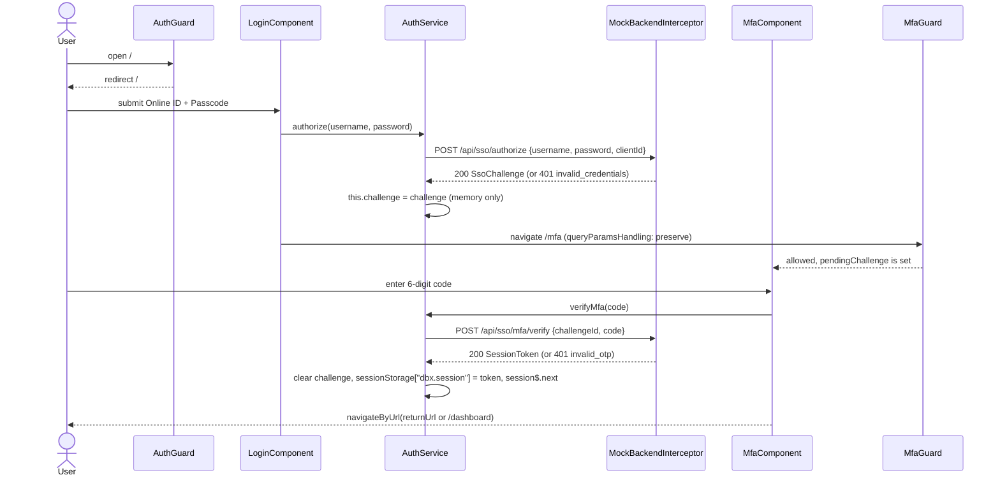

# Sign-in

Sign-in is a two-step flow against a mocked Enterprise SSO service: a username and passcode produce an in-memory SSO challenge, then a six-digit one-time code exchanges that challenge for a session token stored in `sessionStorage`. Two class-based guards decide who can reach the protected routes and the MFA step.

Active contributors: Deepak Sekar

## Purpose

This feature owns the `/login` and `/mfa` screens and the session lifecycle that every other feature depends on. The auth service, guards and HTTP interceptors it relies on carry a `@security-reviewed SEC-2291` header, so behavior changes there need a new AppSec review under gate G3 (see [Upgrade gates](../background/upgrade-gates.md) and [Security](../security.md)).

## Directory layout

```
src/app/features/auth/
  auth.module.ts        routes: login, mfa (MfaGuard)
  login.component.ts    Online ID + Passcode form (inline template)
  mfa.component.ts      one-time code form (inline template)
src/app/core/auth/
  auth.service.ts       authorize, verifyMfa, logout, token, session restore
  auth.guard.ts         canActivate + canLoad for protected routes
  auth.guard.spec.ts    guard unit tests
  mfa.guard.ts          allows /mfa only with a pending challenge
```

## Key abstractions

| Name | File | Role |
|---|---|---|
| `AuthService` | `src/app/core/auth/auth.service.ts` | Calls `/api/sso/authorize` and `/api/sso/mfa/verify`, holds the pending `SsoChallenge` in a private field, keeps the `SessionToken` in a `BehaviorSubject` and in `sessionStorage` key `dbx.session`, exposes `token`, `isAuthenticated`, `pendingChallenge`, `user$`, `logout()` |
| `AuthGuard` | `src/app/core/auth/auth.guard.ts` | `canActivate` and `canLoad` for `/dashboard`, `/accounts`, `/transfers`, `/bill-pay`. Returns a `UrlTree` to `/login?returnUrl=<url>` when not authenticated |
| `MfaGuard` | `src/app/core/auth/mfa.guard.ts` | `canActivate` on `/mfa`. Redirects to `/login` when `pendingChallenge` is undefined |
| `LoginComponent` | `src/app/features/auth/login.component.ts` | Reactive form with required `username` and `password`. Shows `DEMO_CREDENTIALS` as a hint |
| `MfaComponent` | `src/app/features/auth/mfa.component.ts` | `FormControl` with `Validators.pattern(/^\d{6}$/)`. Shows the challenge's `maskedDestination` |
| `SsoChallenge`, `SessionToken`, `User` | `src/app/core/models.ts` | Response shapes (see [Data models](../reference/data-models.md)) |
| `DEMO_CREDENTIALS` | `src/app/core/mock/mock-backend.interceptor.ts` | `demo` / `Demo@1234`, OTP `123456` |

## How it works



Step by step:

1. **Guarded entry.** `AuthGuard.check()` returns `true` when `AuthService.isAuthenticated`, otherwise `router.createUrlTree(['/login'], { queryParams: { returnUrl } })`. For `canActivate` the return URL is `state.url`; for `canLoad` it is `/` plus the route path, so a first visit to a lazy route returns to the module root. The spec `src/app/core/auth/auth.guard.spec.ts` checks that `/transfers` serializes to `/login?returnUrl=%2Ftransfers`.
2. **Login.** `LoginComponent.submit()` marks fields touched if the form is invalid. Otherwise it calls `AuthService.authorize()`, which posts to `${environment.ssoUrl}/authorize` (`/api/sso/authorize`) with `clientId: environment.ssoClientId` (`digital-banking-web`). On success the challenge is stored in `AuthService.challenge` and the component navigates to `/mfa`, preserving query params so `returnUrl` survives. On any error it shows "The Online ID or Passcode you entered does not match our records."
3. **MFA step-up.** `MfaGuard` lets the user in only while a challenge is pending. `MfaComponent.verify()` calls `AuthService.verifyMfa(code)`, which posts `{ challengeId, code }` to `/api/sso/mfa/verify`. On success the service clears the challenge, writes the `SessionToken` JSON to `sessionStorage` under `dbx.session` and pushes it into `session$`. The component then calls `navigateByUrl(returnUrl || '/dashboard')`. On error it shows "That code is incorrect or has expired."
4. **Session use.** `AuthService.token` returns the access token only while `expiresAt > Date.now()`. The mock issues tokens that expire 15 minutes after verification. `AuthInterceptor` attaches the token to non-SSO `/api/` calls (see [HTTP pipeline](../systems/http-pipeline.md)).
5. **Restore on reload.** The `session$` subject is seeded by `restore()`, which reads `dbx.session` and drops it if it is expired or not valid JSON. Because the token is in `sessionStorage`, it survives a reload in the same tab but not a new browser session.
6. **Logout.** `logout(redirect = true)` removes `dbx.session`, emits `null` and navigates to `/login`. It is called from the toolbar Sign out button in `src/app/shell.component.ts` and from `ErrorInterceptor` on a 401 from any non-SSO URL.

### Why hash URLs

`src/app/app-routing.module.ts` configures `RouterModule.forRoot(routes, { useHash: true, ... })`. The comment above it explains that some embedded browsers, such as the Factory desktop browser pane, do a full page reload on every `history.pushState`. A reload between `/login` and `/mfa` wipes the SSO challenge, because `AuthService` keeps it only in memory, and `MfaGuard` would then bounce the user back to `/login`. Hash navigation changes only the fragment, so the app stays loaded and the challenge survives. A side effect is that every in-app URL looks like `http://localhost:4200/#/mfa?returnUrl=%2Ftransfers`. This change was uncommitted when the wiki was written (see [Pitfalls](../background/pitfalls.md)).

## Integration points

- **HTTP pipeline.** SSO calls go through `AuthInterceptor` (correlation id only, no bearer) and `ErrorInterceptor`, which deliberately ignores 401s on `/api/sso/` so a wrong passcode does not trigger a logout. See [HTTP pipeline](../systems/http-pipeline.md).
- **Mock backend.** `/api/sso/authorize` and `/api/sso/mfa/verify` are answered by `MockBackendInterceptor`. See [Mock backend](../systems/mock-backend.md) and [API](../api.md).
- **Shell.** `ShellComponent` subscribes to `AuthService.user$` to show the user name and to open the sidenav.
- **Analytics.** The Sign in and Verify buttons carry `anTrack="login_submit"` and `anTrack="mfa_verify"`. The analytics SDK redacts `password` and `otp` keys if they ever appear in event props (see [Analytics SDK](../packages/analytics-sdk.md)).

## Entry points for modification

- Change credentials, OTP or challenge contents in the mock: `DEMO_CREDENTIALS` and the `/api/sso/*` branches in `src/app/core/mock/mock-backend.interceptor.ts`.
- Change SSO endpoint or client id: `ssoUrl` and `ssoClientId` in `src/environments/environment.ts` and `src/environments/environment.prod.ts`.
- Change session storage, expiry handling or logout: `src/app/core/auth/auth.service.ts`. This file is security-reviewed (G3).
- Change which routes are protected: `canLoad` / `canActivate` entries in `src/app/app-routing.module.ts`.
- Converting the class guards to functional guards counts as a behavior change under G3 per `docs/engineering/frontend-upgrade-policy.md`.

## Key source files

| File | Purpose |
|---|---|
| `src/app/features/auth/auth.module.ts` | Declares login and MFA routes, applies `MfaGuard` |
| `src/app/features/auth/login.component.ts` | Login form and error message |
| `src/app/features/auth/mfa.component.ts` | One-time code form, return URL navigation |
| `src/app/core/auth/auth.service.ts` | SSO client, session storage, logout |
| `src/app/core/auth/auth.guard.ts` | Protected route guard with `returnUrl` |
| `src/app/core/auth/auth.guard.spec.ts` | Guard tests |
| `src/app/core/auth/mfa.guard.ts` | MFA step guard |
| `src/app/app-routing.module.ts` | Route table and `useHash: true` |
| `src/app/core/mock/mock-backend.interceptor.ts` | Mock SSO responses and `DEMO_CREDENTIALS` |
