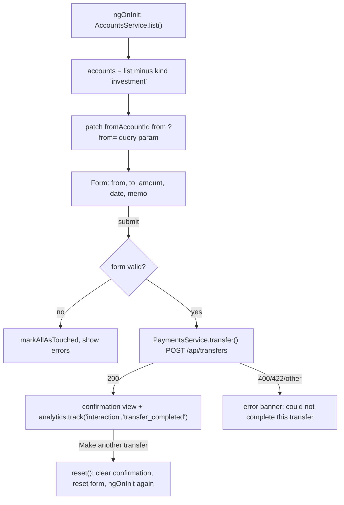

# Transfers

The transfers feature (`/transfers`) moves money between the user's own accounts. A reactive form with a group validator checks the request in the browser, `PaymentsService.transfer()` posts it, and the page swaps to a confirmation view with a confirmation number.

Active contributors: Deepak Sekar

## Purpose

Let the user schedule an internal transfer, reject obviously invalid requests before they reach the API, and record a `transfer_completed` analytics event.

## Directory layout

```
src/app/features/transfers/
  transfers.module.ts              route ''
  transfer.component.ts            form, submit, reset
  transfer.component.html          form view and #done confirmation view
  transfer.validators.ts           transferValidator(getAccounts)
  transfer.validators.spec.ts      validator tests
```

## Key abstractions

| Name | File | Role |
|---|---|---|
| `TransferComponent` | `src/app/features/transfers/transfer.component.ts` | Builds the form, loads accounts, submits, shows confirmation |
| `transferValidator(getAccounts)` | `src/app/features/transfers/transfer.validators.ts` | Group `ValidatorFn`. Sets `sameAccount: true` when from and to match, and `insufficientFunds: { available }` when amount exceeds the source's `available` |
| `PaymentsService.transfer()` | `src/app/core/services/payments.service.ts` | `POST /api/transfers` with a `TransferRequest`, returns `Confirmation` |
| `TransferRequest`, `Confirmation` | `src/app/core/models.ts` | Request and response shapes |

## How it works



### Form rules

| Control | Validators | Message in template |
|---|---|---|
| `fromAccountId` | required | none |
| `toAccountId` | required | none |
| `amount` | required, `min(0.01)`, `max(25000)` | "Enter an amount greater than $0", "Online transfers are limited to $25,000" |
| `date` | required, defaults to today, datepicker `min` is today | none |
| `memo` | `maxLength(64)` | none |
| group | `transferValidator(() => this.accounts)` | "Choose two different accounts." (warning), "Amount exceeds the available balance of ..." (error) |

The validator receives a getter rather than an array, so it always sees the latest account list after `ngOnInit` loads it. Investment accounts are filtered out of both dropdowns. The "From" options show the available balance.

### Submission

`submit()` converts `amount` with `Number()` and `date` with `toISOString()` and posts the request. On success it stores the `Confirmation` and calls `AnalyticsService.track('interaction', 'transfer_completed', { amount, accountNumber: fromAccountId })`. The SDK's `scrub()` replaces the `accountNumber` value with `[REDACTED]` before queuing (see [Analytics SDK](../packages/analytics-sdk.md)). On any error the page shows a generic error banner; server error codes are not shown to the user.

### Mock side effects

The mock in `src/app/core/mock/mock-backend.interceptor.ts` re-validates: unknown or identical accounts return 400 `invalid_accounts`, and `amount <= 0` or `amount > from.available` returns 422 `insufficient_funds`. A successful transfer debits `balance` and `available` on the source, credits the destination, prepends two pending `Transfer` transactions, and returns `{ confirmationNumber: 'DBX1000NN', status: 'completed' }`. The mock does not enforce the $25,000 limit or the date. These changes live in memory and reset on a full page reload. See [Mock backend](../systems/mock-backend.md).

## Integration points

- Entered from the sidenav or from [account detail](accounts.md) with `?from=<accountId>`.
- Uses `dbsMask` and `dbsAmount` pipes and `dbs-alert-banner` from [`@dbs-demo/ui`](../packages/ui.md).
- Uses `AnalyticsService` and `[anTrack]="transfer_submit"` from [`@dbs-demo/analytics-sdk`](../packages/analytics-sdk.md).
- Endpoint contract in [API](../api.md).

## Entry points for modification

- Client-side rules: `src/app/features/transfers/transfer.validators.ts` and the control validators in `src/app/features/transfers/transfer.component.ts`. Update `src/app/features/transfers/transfer.validators.spec.ts` alongside.
- Which accounts are eligible: the `filter` in `TransferComponent.ngOnInit()`.
- Server-side mock rules: `transfer()` in `src/app/core/mock/mock-backend.interceptor.ts`.

## Key source files

| File | Purpose |
|---|---|
| `src/app/features/transfers/transfers.module.ts` | Route |
| `src/app/features/transfers/transfer.component.ts` | Form, submit, analytics event |
| `src/app/features/transfers/transfer.component.html` | Form and confirmation templates |
| `src/app/features/transfers/transfer.validators.ts` | Same-account and funds validator |
| `src/app/features/transfers/transfer.validators.spec.ts` | Validator tests |
| `src/app/core/services/payments.service.ts` | `transfer()` call |
| `src/app/core/mock/mock-backend.interceptor.ts` | Mock transfer handling |
