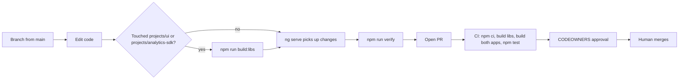

# Development workflow

The day-to-day loop for changing code here: branch from `main`, run the app against the mock backend, rebuild libraries when you touch them, run `npm run verify`, and open a PR that CI checks. Setup steps are in [getting started](../overview/getting-started.md).

## Branches and PRs

- `main` is the only branch (local `main` tracking `origin/main` on `https://github.com/jan21deepak/droid_consumerbanking_app`).
- Work on a feature branch and open a pull request against `main`.
- `.github/workflows/ci.yml` runs on every `pull_request` and on pushes to `main`.
- Review requirements come from `.github/CODEOWNERS`. See [contributing](index.md#code-review-and-ownership).
- Existing commits use Conventional Commit prefixes (`feat:`, `refactor:`) with a short body explaining the change.



## The local loop

### Apps

```bash
npm start              # prestart builds both libs, then ng serve digital-banking on :4200
npm run start:wealth   # ng serve wealth-portal on :4300 (does not rebuild libs)
```

The dev server rebuilds on file changes inside the app being served. The retail app uses hash URLs (`http://localhost:4200/#/dashboard`). All `/api/*` calls are answered by `src/app/core/mock/mock-backend.interceptor.ts`, so there is no backend to start. See [mock backend](../systems/mock-backend.md).

### Libraries

Apps do not compile library source directly. `tsconfig.json` maps `@dbs-demo/ui` to `dist/ui` and `@dbs-demo/analytics-sdk` to `dist/analytics-sdk`, so the apps import the ng-packagr output. After changing anything in `projects/ui/` or `projects/analytics-sdk/`:

```bash
npm run build:libs     # ng build ui && ng build analytics-sdk
```

Then restart `ng serve` so it picks up the new `dist/` output. A missing or stale `dist/` folder shows up as "Cannot find module '@dbs-demo/ui'" or as old behavior. More in [packages](../packages/index.md) and [pitfalls](../background/pitfalls.md).

### Before pushing

```bash
npm run verify
```

This is `npm run build && npm test`: build both libraries, build `digital-banking` and `wealth-portal`, then run the Karma suites for `ui`, `analytics-sdk`, `digital-banking` and `wealth-portal` in that order. CI runs the same steps (with the build split into separate named steps). See [deployment](../deployment.md) for the workflow file.

## What CI does

`.github/workflows/ci.yml` has one job, "Build & test (libs + all consumers)", on `ubuntu-latest`:

1. `actions/checkout@v4`
2. `actions/setup-node@v4` with `node-version-file: .nvmrc` (Node 16) and npm caching
3. `npm ci`
4. `npm run build:libs`
5. `npx ng build digital-banking`
6. `npx ng build wealth-portal`
7. `npm test`

There is no lint, format or e2e step. See [tooling](tooling.md).

## Upgrade work

If your change is part of the Angular upgrade, the PR needs extra evidence (verify output, smoke-test screenshots, Decisions and Deferred tables) and class B changes need sign-off before you make them. Keep changes to other teams' projects in separate commits. See [upgrade gates](../background/upgrade-gates.md) and section 3 of `docs/engineering/frontend-upgrade-policy.md`.
