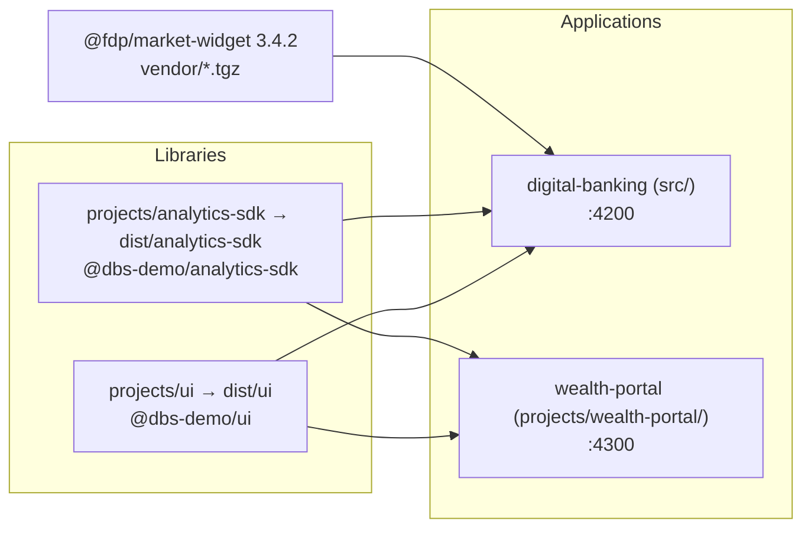

# Architecture

The workspace builds two libraries first, then two applications that import the built libraries. At runtime the retail app is an NgModule-based single-page app whose HTTP calls pass through a chain of interceptors that ends in an in-browser mock backend.

## Workspace and build graph

`angular.json` defines four projects. The libraries are built with ng-packagr (`projects/ui/ng-package.json`, `projects/analytics-sdk/ng-package.json`) into `dist/ui` and `dist/analytics-sdk`. `tsconfig.json` maps the package names to those folders:

- `@dbs-demo/ui` → `dist/ui`
- `@dbs-demo/analytics-sdk` → `dist/analytics-sdk`

Because the apps resolve the libraries from `dist/`, the libraries must be built first. The `build:libs` script in `package.json` does this, and `prestart` and `build` both call it.



The wealth portal imports both `@dbs-demo/ui` and `@dbs-demo/analytics-sdk` (`projects/wealth-portal/src/app/app.module.ts`). It does not import a vendor widget. It is the "downstream consumer" whose build must not break when the shared library changes ([Wealth portal](../apps/wealth-portal.md)).

## Retail app structure

`src/main.ts` bootstraps `AppModule` (`src/app/app.module.ts`). Its root component is `ShellComponent` (`src/app/shell.component.ts`), which renders the toolbar, the side navigation (shown only when a user is signed in), and the router outlet.

| Module | File | Role |
| --- | --- | --- |
| `AppModule` | `src/app/app.module.ts` | Root module, imports `CoreModule`, routing, Material shell modules, `DbsUiModule`, `AnalyticsModule.forRoot()` |
| `CoreModule` | `src/app/core/core.module.ts` | `HttpClientModule` and the HTTP interceptors; throws if imported twice |
| `AppRoutingModule` | `src/app/app-routing.module.ts` | Hash-based routes, lazy feature modules, `AuthGuard` |
| `SharedModule` | `src/app/shared/shared.module.ts` | Re-exports forms, flex-layout, Material modules, `DbsUiModule`, `AnalyticsModule` for feature modules |
| Feature modules | `src/app/features/*/` | `auth`, `dashboard`, `accounts`, `transfers`, `bill-pay`, each lazy-loaded |

Routing uses hash URLs (`useHash: true`), so addresses look like `/#/dashboard`. This was added because the Factory desktop browser pane does a full page reload on `history.pushState`, which wiped the in-memory SSO challenge between the login and MFA steps. See [Pitfalls](../background/pitfalls.md).

## Runtime request flow

Services in `src/app/core/services/` call `HttpClient` with relative `/api/...` URLs. Each request passes through the interceptors in registration order. `MockBackendInterceptor` answers any `/api/` request and never forwards it, so the analytics timing interceptor registered after it is never reached for API calls.

```mermaid
sequenceDiagram
    participant C as Component
    participant S as Service (core/services)
    participant A as AuthInterceptor
    participant E as ErrorInterceptor
    participant M as MockBackendInterceptor
    C->>S: e.g. accounts()
    S->>A: GET /api/accounts
    A->>E: + Authorization: Bearer, X-Correlation-Id
    E->>M: pass through
    M-->>E: HttpResponse after 250 ms (or error)
    E-->>S: on 401 logout; on 5xx/0 toast
    S-->>C: Observable result
```

Details of each interceptor are in [HTTP pipeline](../systems/http-pipeline.md), and the mocked endpoints are listed in [API](../api.md) and [Mock backend](../systems/mock-backend.md).

## Sign-in model

Sign-in is a two-step SSO flow. `AuthService` (`src/app/core/auth/auth.service.ts`) posts credentials to `/api/sso/authorize` and keeps the returned challenge in memory. The MFA step posts the one-time code to `/api/sso/mfa/verify` and stores the `SessionToken` in `sessionStorage` under `dbx.session`. `AuthGuard` (`src/app/core/auth/auth.guard.ts`) protects every feature route; `MfaGuard` (`src/app/core/auth/mfa.guard.ts`) only allows `/mfa` while a challenge exists. The auth and HTTP files carry a `@security-reviewed SEC-2291` header. See [Sign-in](../features/sign-in.md) and [Security](../security.md).

## Analytics

`AnalyticsModule.forRoot()` in `AppModule` configures `AnalyticsService` (`projects/analytics-sdk/src/lib/analytics.service.ts`). It records a `page_view` on every `NavigationEnd`, records clicks through the `[anTrack]` directive, redacts sensitive keys, and flushes its queue every 10 seconds by POSTing to `/api/analytics`. See [Analytics SDK](../packages/analytics-sdk.md).

## Code by language

Counts are lines in git-tracked files, excluding `package-lock.json` and the vendor tarball. Full statistics are in [By the numbers](../by-the-numbers.md).

| Language | Files | Lines |
| --- | --- | --- |
| TypeScript | 67 | 2,070 |
| JSON | 17 | 558 |
| HTML | 6 | 202 |
| JavaScript (Karma configs) | 4 | 188 |
| SCSS | 4 | 139 |
| Markdown | 4 | 121 |

Most component templates are inline in the `.ts` files, which is why HTML is small.

## Related pages

- [Getting started](getting-started.md)
- [Digital banking app](../apps/digital-banking.md)
- [Packages](../packages/index.md)
- [Upgrade gates](../background/upgrade-gates.md)
