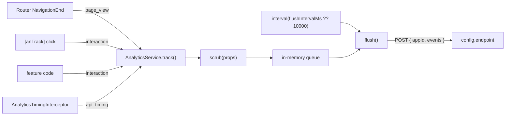

# Analytics SDK

`@dbs-demo/analytics-sdk` (version 2.7.1, `projects/analytics-sdk/`) records page views, click interactions, and API latency in the browser, redacts PII fields, and posts batches to a configured endpoint. Apps enable it with `AnalyticsModule.forRoot(config)`.

Active contributors: Deepak Sekar

## Purpose

The SDK gives every app one way to emit analytics events without each feature writing HTTP code. It is owned by `@dbs-demo/analytics-platform` (`.github/CODEOWNERS`), which makes it another team's code under upgrade gate G5 (see [Upgrade gates](../background/upgrade-gates.md)).

## Directory layout

```
projects/analytics-sdk/
  package.json             @dbs-demo/analytics-sdk 2.7.1, peers on Angular common/core/router ^14.2.0
  ng-package.json          dest ../../dist/analytics-sdk
  README.md
  karma.conf.js, tsconfig.lib.json, tsconfig.lib.prod.json, tsconfig.spec.json
  src/
    public-api.ts
    test.ts
    lib/
      analytics.config.ts        AnalyticsConfig, ANALYTICS_CONFIG, AnalyticsEvent
      analytics.module.ts        AnalyticsModule.forRoot()
      analytics.service.ts       queue, page views, flush, scrub
      analytics.service.spec.ts
      track.directive.ts         [anTrack]
      timing.interceptor.ts      api_timing beacons
```

## Key abstractions

| Name | File | What it does |
| --- | --- | --- |
| `AnalyticsConfig` | `projects/analytics-sdk/src/lib/analytics.config.ts` | `appId`, `endpoint`, optional `flushIntervalMs`, `redactFields`, `debug` |
| `ANALYTICS_CONFIG` | `projects/analytics-sdk/src/lib/analytics.config.ts` | `InjectionToken<AnalyticsConfig>` |
| `AnalyticsEvent` | `projects/analytics-sdk/src/lib/analytics.config.ts` | `{ type: 'page_view' \| 'interaction' \| 'api_timing' \| 'error', name, timestamp, props? }` |
| `AnalyticsModule` | `projects/analytics-sdk/src/lib/analytics.module.ts` | Declares and exports `TrackDirective`. `forRoot(config)` also provides `ANALYTICS_CONFIG`, `AnalyticsService`, and `AnalyticsTimingInterceptor` as an `HTTP_INTERCEPTORS` multi provider. |
| `AnalyticsService` | `projects/analytics-sdk/src/lib/analytics.service.ts` | Holds the event queue. `track()`, `flush()`, `scrub()`, `pending`. Not `providedIn: 'root'`; only `forRoot()` provides it. |
| `TrackDirective` | `projects/analytics-sdk/src/lib/track.directive.ts` | `[anTrack]="name"` with optional `[anTrackProps]`; tracks an `interaction` on click |
| `AnalyticsTimingInterceptor` | `projects/analytics-sdk/src/lib/timing.interceptor.ts` | Tracks `api_timing` with `status` and `ms` for each `HttpResponse`, skipping URLs that start with the analytics endpoint |

## How it works



1. **Construction.** `AnalyticsService` merges the default redact list with `config.redactFields`, subscribes to `Router.events` filtered to `NavigationEnd` (tracking `page_view` with `urlAfterRedirects`), and starts an `interval` that calls `flush()` every `flushIntervalMs` (default 10000 ms).
2. **Tracking.** `track(type, name, props?)` stamps `Date.now()`, passes `props` through `scrub()`, pushes the event onto the queue, and logs it with `console.debug('[analytics]', event)` when `config.debug` is true.
3. **Redaction.** `scrub()` replaces the value of any top-level key in the redact list with `'[REDACTED]'`. The defaults are `accountNumber`, `ssn`, `routingNumber`, `cardNumber`, `password`, and `otp`. Matching is by exact key name and is not recursive, so a nested object containing `accountNumber` is not scrubbed.
4. **Flushing.** `flush()` returns `0` if the queue is empty. Otherwise it removes all events from the queue with `splice`, posts `{ appId, events }` to `config.endpoint`, awaits the result with `.toPromise()`, and returns the batch size. Events are removed before the request, so a failed post loses that batch. The interval subscription does not catch the returned promise.
5. **Timing.** `AnalyticsTimingInterceptor` records `performance.now()` before `next.handle(req)` and tracks `api_timing` named `"<METHOD> <urlWithParams>"` when the `HttpResponse` arrives. It skips the analytics endpoint so beacons do not time themselves.

### Configuration in the apps

| App | Call | Notes |
| --- | --- | --- |
| [digital-banking](../apps/digital-banking.md) | `AnalyticsModule.forRoot({ appId: 'digital-banking-web', endpoint: environment.analyticsEndpoint, debug: !environment.production })` in `src/app/app.module.ts` | `analyticsEndpoint` is `/api/analytics`, answered by the mock backend with `{ accepted: true }` |
| [wealth-portal](../apps/wealth-portal.md) | `AnalyticsModule.forRoot({ appId: 'wealth-portal', endpoint: '/api/analytics' })` in `projects/wealth-portal/src/app/app.module.ts` | No mock backend in this app |

`src/app/shared/shared.module.ts` imports and exports plain `AnalyticsModule` so lazy feature modules get `TrackDirective` without creating a second `AnalyticsService`.

In digital-banking, `CoreModule` is imported before `AnalyticsModule.forRoot()`, so the timing interceptor sits after `MockBackendInterceptor` in the chain. The mock answers `/api/` requests without calling the next handler, which means `api_timing` events are not produced for mocked calls. See [HTTP pipeline](../systems/http-pipeline.md).

### Where events come from in digital-banking

| Event | Source |
| --- | --- |
| `login_submit` | `anTrack` in `src/app/features/auth/login.component.ts` |
| `mfa_verify` | `anTrack` in `src/app/features/auth/mfa.component.ts` |
| `account_tile_open` with `{ kind }` | `anTrack` in `src/app/features/dashboard/dashboard.component.html` |
| `transfer_submit` | `anTrack` in `src/app/features/transfers/transfer.component.html` |
| `transfer_completed` with `{ amount, accountNumber }` | `AnalyticsService.track()` in `src/app/features/transfers/transfer.component.ts`; `accountNumber` is redacted |
| `billpay_submit` | `anTrack` in `src/app/features/bill-pay/bill-pay.component.html` |
| `page_view` | every `NavigationEnd` |

## Tests

`projects/analytics-sdk/src/lib/analytics.service.spec.ts` uses `HttpClientTestingModule` and `RouterTestingModule` with `flushIntervalMs: 60000` and checks that `accountNumber` is redacted before queueing and that `flush()` posts both queued events to the configured endpoint, returns `2`, and empties the queue. See [Testing](../how-to-contribute/testing.md).

## Upgrade-relevant patterns

- **`toPromise()`** in `flush()` in `projects/analytics-sdk/src/lib/analytics.service.ts`. Deprecated in RxJS 7 and removed in RxJS 8; the replacement is `firstValueFrom` / `lastValueFrom`.
- **Class-based `HttpInterceptor`** registered through `HTTP_INTERCEPTORS` in `forRoot()`, rather than a functional interceptor with `withInterceptors`.
- **`ModuleWithProviders` / `forRoot()`** NgModule configuration rather than a `provideAnalytics()` function.

Because this is another team's library, the policy allows only class A (mechanical) changes here, in a separate commit, with `@dbs-demo/analytics-platform` as reviewers. See [Upgrade gates](../background/upgrade-gates.md).

## Integration points

- Angular `Router` (page views) and `HttpClient` (flush). The host app must provide both; `forRoot()` does not import `HttpClientModule`.
- `HTTP_INTERCEPTORS` for timing beacons.
- Redaction behaviour is part of the app's PII handling; see [Security](../security.md).

## Entry points for modification

- **Track a new click**: add `anTrack="event_name"` (and optionally `[anTrackProps]`) to an element in any module that imports `SharedModule`.
- **Track from code**: inject `AnalyticsService` and call `track('interaction', name, props)`.
- **Redact another field**: pass `redactFields` in the app's `forRoot()` config, or add to `DEFAULT_REDACT` in `projects/analytics-sdk/src/lib/analytics.service.ts` (a library change).
- **Change batching**: pass `flushIntervalMs` in config.
- Rebuild with `ng build analytics-sdk` before the apps see library changes ([Packages](index.md)).

## Key source files

| File | Purpose |
| --- | --- |
| `projects/analytics-sdk/src/lib/analytics.config.ts` | Config interface, injection token, event type |
| `projects/analytics-sdk/src/lib/analytics.module.ts` | `AnalyticsModule.forRoot()` |
| `projects/analytics-sdk/src/lib/analytics.service.ts` | Queue, page views, flush with `toPromise()`, redaction |
| `projects/analytics-sdk/src/lib/track.directive.ts` | `[anTrack]` click tracking |
| `projects/analytics-sdk/src/lib/timing.interceptor.ts` | `api_timing` beacons |
| `projects/analytics-sdk/src/lib/analytics.service.spec.ts` | Redaction and flush tests |
| `projects/analytics-sdk/src/public-api.ts` | Public exports |
| `projects/analytics-sdk/package.json` | Version and peer dependencies |
| `projects/analytics-sdk/ng-package.json` | Build destination |
| `projects/analytics-sdk/README.md` | Usage snippet |
