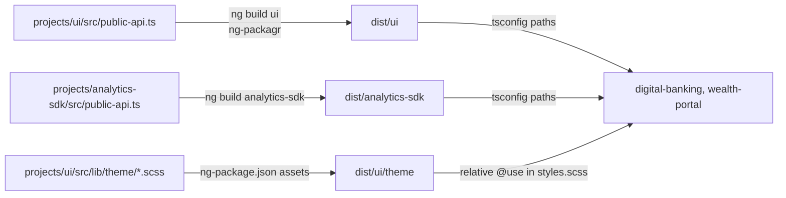

# Packages

The workspace contains two Angular libraries built with ng-packagr: the `@dbs-demo/ui` design system and the `@dbs-demo/analytics-sdk` analytics SDK. Both apps import them by package name, and those names resolve to the built output in `dist/`, so the libraries must be built before either app compiles.

## The two libraries

| Package | Version | Source | Build output | Selector prefix | Owner (`.github/CODEOWNERS`) | Page |
| --- | --- | --- | --- | --- | --- | --- |
| `@dbs-demo/ui` | 4.2.0 | `projects/ui/` | `dist/ui` | `dbs` | `@dbs-demo/design-system` | [UI library](ui.md) |
| `@dbs-demo/analytics-sdk` | 2.7.1 | `projects/analytics-sdk/` | `dist/analytics-sdk` | `an` | `@dbs-demo/analytics-platform` | [Analytics SDK](analytics-sdk.md) |

Both declare Angular `^14.2.0` peer dependencies in their `package.json` and depend only on `tslib`. `@dbs-demo/ui` also peers on `@angular/material` and `@angular/cdk`; `@dbs-demo/analytics-sdk` peers on `@angular/router`.

## Build and path mapping

- Each library has its own ng-package.json (for example `projects/ui/ng-package.json`) that sets `dest` to `../../dist/<name>` and `lib.entryFile` to `src/public-api.ts`. The `ui` library also copies `src/lib/theme/**/*.scss` to `dist/ui/theme`.
- `angular.json` uses the `@angular-devkit/build-angular:ng-packagr` builder with `production` as the default configuration. `projects/ui/tsconfig.lib.prod.json` sets `compilationMode: "partial"` (partial Ivy output, the format for publishable libraries).
- `tsconfig.json` maps `@dbs-demo/ui` to `dist/ui` and `@dbs-demo/analytics-sdk` to `dist/analytics-sdk`. TypeScript imports in the apps therefore read the compiled library, not the source.
- The theme is not resolved through `paths`. Both app stylesheets reach into `dist/` with relative paths: `src/styles.scss` uses `../dist/ui/theme/theme` and `projects/wealth-portal/src/styles.scss` uses `../../../dist/ui/theme/theme`.

The `build:libs` script in `package.json` runs `ng build ui && ng build analytics-sdk`. `prestart` and `build` call it, and `npm test` calls it before testing the apps. `npm run start:wealth` does not, so run `build:libs` first. A stale `dist/` is a common source of confusing errors after editing library code; see [Pitfalls](../background/pitfalls.md).

## Who consumes what

| Consumer | `@dbs-demo/ui` | `@dbs-demo/analytics-sdk` |
| --- | --- | --- |
| [digital-banking](../apps/digital-banking.md) | `DbsUiModule` in `AppModule` and `SharedModule`, `DbsToastService`, theme mixin | `AnalyticsModule.forRoot()` in `AppModule`, `AnalyticsModule` in `SharedModule`, `AnalyticsService`, `[anTrack]` |
| [wealth-portal](../apps/wealth-portal.md) | `DbsUiModule`, `DbsAmountPipe` (in spec), theme mixin | `AnalyticsModule.forRoot()` |

## Tests

Each library has its own Karma target in `angular.json` (`projects/ui/karma.conf.js`, `projects/analytics-sdk/karma.conf.js`). Specs are `projects/ui/src/lib/pipes/amount.pipe.spec.ts`, `projects/ui/src/lib/pipes/mask.pipe.spec.ts`, and `projects/analytics-sdk/src/lib/analytics.service.spec.ts`. `npm test` runs the library tests first. See [Testing](../how-to-contribute/testing.md).

## Upgrade relevance

Both libraries are gated by the upgrade policy. Changes to the public API or visual output of `@dbs-demo/ui` fall under gate G4, and `@dbs-demo/analytics-sdk` is another team's code under gate G5. See [Upgrade gates](../background/upgrade-gates.md).

## Key source files

| File | Purpose |
| --- | --- |
| `projects/ui/ng-package.json` | `ui` build destination and theme asset copy |
| `projects/ui/package.json` | `@dbs-demo/ui` name, version, peers |
| `projects/ui/src/public-api.ts` | `ui` exports |
| `projects/analytics-sdk/ng-package.json` | `analytics-sdk` build destination |
| `projects/analytics-sdk/package.json` | `@dbs-demo/analytics-sdk` name, version, peers |
| `projects/analytics-sdk/src/public-api.ts` | `analytics-sdk` exports |
| `tsconfig.json` | `paths` mapping to `dist/` |
| `angular.json` | `ui` and `analytics-sdk` build and test targets |
| `package.json` | `build:libs` and the scripts that call it |
