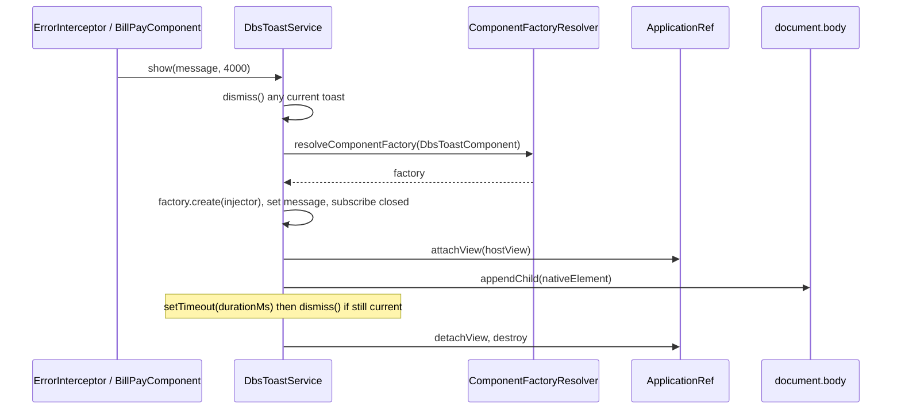

# UI library

`@dbs-demo/ui` (version 4.2.0, `projects/ui/`) is the shared design system layered on Angular Material 14. It provides four components, two pipes, an imperative toast service, and a Sass theme mixin, and it is consumed by both [digital-banking](../apps/digital-banking.md) and [wealth-portal](../apps/wealth-portal.md).

Active contributors: Deepak Sekar

## Purpose

The library gives every Digital Banking surface the same page header, account tile, alert banner, toast, money formatting, and PII masking, plus a Material theme with DBS graphite and red palettes. `projects/ui/README.md` warns that a breaking change here breaks downstream builds. `.github/CODEOWNERS` assigns `/projects/ui/` to `@dbs-demo/design-system`.

## Directory layout

```
projects/ui/
  package.json            @dbs-demo/ui 4.2.0, peers on Angular/Material/CDK ^14.2.0
  ng-package.json         dest ../../dist/ui, copies theme/*.scss to dist/ui/theme
  README.md
  karma.conf.js, tsconfig.lib.json, tsconfig.lib.prod.json, tsconfig.spec.json
  src/
    public-api.ts         exports module, components, service, pipes
    test.ts
    lib/
      ui.module.ts
      components/         page-header, account-tile, alert-banner, toast
      pipes/              mask.pipe.ts, amount.pipe.ts (+ specs)
      services/           toast.service.ts
      theme/_theme.scss
```

## Key abstractions

| Name | Selector / name | File | Inputs and outputs |
| --- | --- | --- | --- |
| `DbsUiModule` | | `projects/ui/src/lib/ui.module.ts` | Declares and exports all components and pipes. Imports `CommonModule`, `MatButtonModule`, `MatCardModule`, `MatIconModule`. Lists `DbsToastComponent` in `entryComponents`. |
| `DbsPageHeaderComponent` | `dbs-page-header` | `projects/ui/src/lib/components/page-header.component.ts` | `title`, `subtitle?`, `eyebrow?`; projects content into a right-aligned actions slot |
| `DbsAccountTileComponent` | `dbs-account-tile` | `projects/ui/src/lib/components/account-tile.component.ts` | `name`, `accountNumber`, `balance`, `kind` (`DbsAccountKind`: `checking`, `savings`, `credit`, `investment`); output `select`. `OnPush`. |
| `DbsAlertBannerComponent` | `dbs-alert-banner` | `projects/ui/src/lib/components/alert-banner.component.ts` | `level` (`DbsAlertLevel`: `info`, `success`, `warning`, `error`), `dismissible`; output `dismissed`. Renders `role="alert"`. |
| `DbsToastComponent` | `dbs-toast` | `projects/ui/src/lib/components/toast.component.ts` | `message`; output `closed`. Fixed bottom-right, `role="status"`. |
| `DbsToastService` | | `projects/ui/src/lib/services/toast.service.ts` | `show(message, durationMs = 4000)`, `dismiss()`. `providedIn: 'root'`. |
| `DbsMaskPipe` | `dbsMask` | `projects/ui/src/lib/pipes/mask.pipe.ts` | `transform(value, visible = 4)` |
| `DbsAmountPipe` | `dbsAmount` | `projects/ui/src/lib/pipes/amount.pipe.ts` | `transform(value, showSign = false)` |
| `dbs-design-system()` | Sass mixin | `projects/ui/src/lib/theme/_theme.scss` | Includes Material core and component themes plus DBS overrides |

## How it works

### Components

- **Account tile** wraps a `mat-card`. It picks an icon from `kind` (`account_balance`, `savings`, `credit_card`, `trending_up`), shows `accountNumber | dbsMask` and `balance | dbsAmount`, labels the balance "Current balance" for credit and "Available balance" otherwise, and colours credit balances red. Clicking the card emits `select`.
- **Alert banner** maps `level` to an icon and a CSS modifier class `dbs-alert--<level>`, and shows a close button only when `dismissible` is true.
- **Page header** renders an optional uppercase red eyebrow, an `h1` title, and an optional subtitle.
- **Toast** is a plain component with an OK button that emits `closed`. It is meant to be created by `DbsToastService`, not placed in templates.

### Pipes

`DbsAmountPipe` formats with Angular's `CurrencyPipe('en-US')` as USD with two decimals. It formats the absolute value and prefixes `-` for negatives, so `-42` becomes `-$42.00` rather than `($42.00)`. With `showSign` true, positives get a `+`. `null`, `undefined`, and `NaN` render as an em dash.

`DbsMaskPipe` strips non-digits and returns `••••` plus the last `visible` digits. Values with `visible` digits or fewer come back unmasked (digits only). Empty input returns an empty string.

Both behaviours are pinned by `projects/ui/src/lib/pipes/amount.pipe.spec.ts` and `projects/ui/src/lib/pipes/mask.pipe.spec.ts`.

### Toast service



Only one toast exists at a time. The service is used by `src/app/core/http/error.interceptor.ts` (server and network errors) and `src/app/features/bill-pay/bill-pay.component.ts`.

### Theme

`projects/ui/src/lib/theme/_theme.scss` defines `$dbs-graphite` (500 = `#1a1a1a`) and `$dbs-red` (500 = `#ec1c24`) palettes, builds `$dbs-theme` with `mat.define-light-theme`, and builds `$dbs-typography` with `mat.define-typography-config` using `headline` and `title` levels. The `dbs-design-system()` mixin includes `mat.core($dbs-typography)` and `mat.all-component-themes($dbs-theme)`, then overrides Material internals:

| Selector | Change |
| --- | --- |
| `.mat-form-field-appearance-outline .mat-form-field-outline` | Outline colour `#bfbfbf` |
| `.mat-form-field-appearance-outline.mat-focused .mat-form-field-outline-thick` | Focused outline `#1a1a1a` |
| `.mat-raised-button.mat-primary`, `.mat-flat-button.mat-primary` | Pill shape, 24px padding |
| `.mat-card` | 12px radius |
| `.mat-tab-label-active` | Graphite, full opacity |
| `.mat-chip.mat-standard-chip` | 26px min height |

`projects/ui/ng-package.json` copies the file to `dist/ui/theme`, and `src/styles.scss` and `projects/wealth-portal/src/styles.scss` each do `@use '<relative path>/dist/ui/theme/theme' as dbs; @include dbs.dbs-design-system();`. The README documents the import as `@use '@dbs-demo/ui/theme'`, but neither app uses that form.

## Upgrade-relevant patterns

Most of this library is in scope of gate G4 (shared-library API or visual change). See [Upgrade gates](../background/upgrade-gates.md).

- **`entryComponents`** in `projects/ui/src/lib/ui.module.ts`. Deprecated since Ivy and removed from the `NgModule` type in later versions.
- **`ComponentFactoryResolver`** in `projects/ui/src/lib/services/toast.service.ts`, described in its own doc comment as the "pre-v13 dynamic component pattern". Deprecated in Angular 13 in favour of `createComponent` / `ViewContainerRef.createComponent`.
- **Legacy `.mat-*` overrides** in `projects/ui/src/lib/theme/_theme.scss`. The file header says it targets "legacy, non-MDC components". The Material 15 MDC migration changes DOM, class names, and density, so these selectors stop matching.
- **`mat.define-typography-config` with `headline` / `title` levels**, the pre-MDC typography API that was later replaced by M2 typography levels.
- Downstream code also depends on legacy classes: `projects/wealth-portal/src/styles.scss` overrides `.mat-table` and `.mat-row`, and its spec queries `tr.mat-row`.

## Integration points

- **digital-banking**: `DbsUiModule` in `src/app/app.module.ts` and `src/app/shared/shared.module.ts`; `DbsToastService` in `src/app/core/http/error.interceptor.ts` and `src/app/features/bill-pay/bill-pay.component.ts`; theme in `src/styles.scss`.
- **wealth-portal**: `DbsUiModule` in `projects/wealth-portal/src/app/app.module.ts`; components in `projects/wealth-portal/src/app/holdings.component.ts`; theme in `projects/wealth-portal/src/styles.scss`.
- **Build**: see [Packages](index.md) for the `dist/ui` path mapping.

## Entry points for modification

- **Add a component or pipe**: create it under `projects/ui/src/lib/`, add it to `DECLARATIONS` in `projects/ui/src/lib/ui.module.ts`, and export it from `projects/ui/src/public-api.ts`. Rebuild with `ng build ui` before the apps see it.
- **Change theme colours or overrides**: `projects/ui/src/lib/theme/_theme.scss`. Check both apps visually afterwards.
- **Change formatting or masking**: the pipe files, with their specs.
- **Verify against the downstream consumer**: `ng build ui` then `ng test wealth-portal --watch=false --browsers=ChromeHeadlessCI`.

Any change to inputs, selectors, exported names, or rendered output needs a major version bump and design-system owner sign-off under gate G4.

## Key source files

| File | Purpose |
| --- | --- |
| `projects/ui/src/lib/ui.module.ts` | `DbsUiModule`, `entryComponents` |
| `projects/ui/src/public-api.ts` | Public exports |
| `projects/ui/src/lib/components/page-header.component.ts` | `dbs-page-header` |
| `projects/ui/src/lib/components/account-tile.component.ts` | `dbs-account-tile` |
| `projects/ui/src/lib/components/alert-banner.component.ts` | `dbs-alert-banner` |
| `projects/ui/src/lib/components/toast.component.ts` | `dbs-toast` |
| `projects/ui/src/lib/services/toast.service.ts` | `DbsToastService`, `ComponentFactoryResolver` |
| `projects/ui/src/lib/pipes/amount.pipe.ts` | `dbsAmount` |
| `projects/ui/src/lib/pipes/mask.pipe.ts` | `dbsMask` |
| `projects/ui/src/lib/theme/_theme.scss` | Palettes, typography, `dbs-design-system()` mixin |
| `projects/ui/ng-package.json` | Build destination and theme asset copy |
| `projects/ui/package.json` | Version and peer dependencies |
| `projects/ui/README.md` | Short usage notes |
