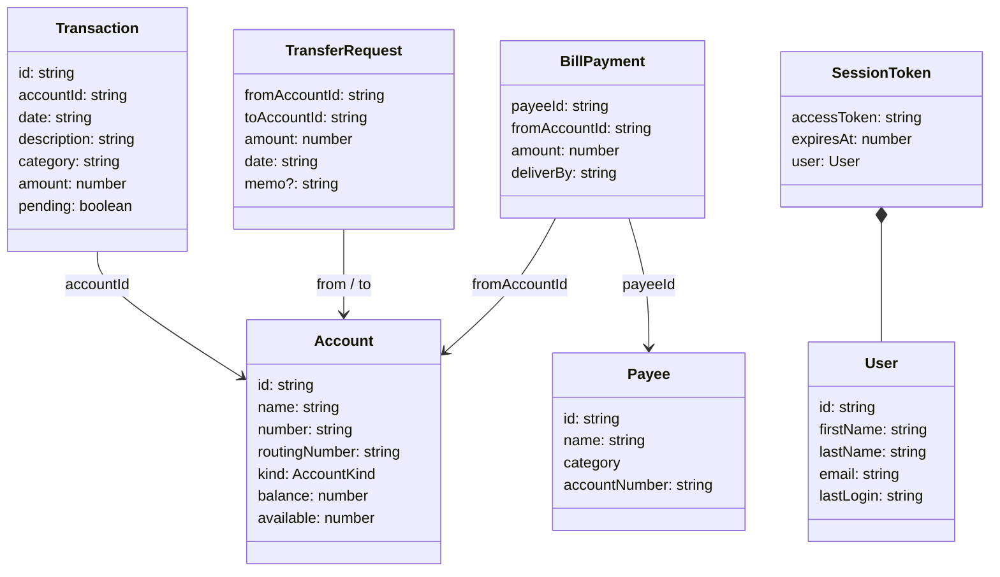

# Data models

All shared TypeScript types for the digital-banking app live in `src/app/core/models.ts`. They describe the JSON exchanged with the (mocked) API, so they double as the API contract documented in [API](../api.md).

## Type map

## Accounts and transactions

### `AccountKind`

`'checking' | 'savings' | 'credit' | 'investment'`. `projects/ui/src/lib/components/account-tile.component.ts` declares its own identical `DbsAccountKind` so the library does not import from the app.

### `Account`

| Field | Type | Notes |
|---|---|---|
| `id` | `string` | Mock ids: `chk-01`, `sav-01`, `cc-01`, `inv-01` |
| `name` | `string` | Display name |
| `number` | `string` | Full account number; masked in templates with `DbsMaskPipe` |
| `routingNumber` | `string` | Empty string for credit and investment accounts in the mock data |
| `kind` | `AccountKind` | |
| `balance` | `number` | Negative for the credit card |
| `available` | `number` | Upper bound for transfers and bill payments in the mock backend |

Returned by `GET /api/accounts` and `GET /api/accounts/:id` (`AccountsService` in `src/app/core/services/accounts.service.ts`) and resolved for the detail page by `AccountResolver` in `src/app/core/services/account.resolver.ts`.

### `Transaction`

| Field | Type | Notes |
|---|---|---|
| `id` | `string` | Mock pattern `<accountId>-t<n>`, or `x<timestamp>a` / `x<timestamp>b` for transfers |
| `accountId` | `string` | References `Account.id` |
| `date` | `string` | ISO 8601 |
| `description` | `string` | |
| `category` | `string` | Free text (for example `Groceries`, `Transfer`) |
| `amount` | `number` | Signed; negative is a debit |
| `pending` | `boolean` | |

Returned by `GET /api/accounts/:id/transactions`.

## Payments

### `TransferRequest`

| Field | Type | Notes |
|---|---|---|
| `fromAccountId` | `string` | |
| `toAccountId` | `string` | Must differ from `fromAccountId` |
| `amount` | `number` | Must be greater than 0 and at most the source `available` |
| `date` | `string` | |
| `memo` | `string?` | Optional |

Sent by `PaymentsService.transfer()` (`src/app/core/services/payments.service.ts`) to `POST /api/transfers`. See [transfers](../features/transfers.md).

### `Payee`

| Field | Type |
|---|---|
| `id` | `string` |
| `name` | `string` |
| `category` | `'utilities' \| 'credit card' \| 'insurance' \| 'telecom' \| 'other'` |
| `accountNumber` | `string` |

Returned by `GET /api/billpay/payees`.

### `BillPayment`

| Field | Type |
|---|---|
| `payeeId` | `string` |
| `fromAccountId` | `string` |
| `amount` | `number` |
| `deliverBy` | `string` |

Sent to `POST /api/billpay/payments`. See [bill pay](../features/bill-pay.md).

### `Confirmation`

| Field | Type | Notes |
|---|---|---|
| `confirmationNumber` | `string` | Mock format `DBX` followed by a six-digit counter starting at 100001 |
| `status` | `'scheduled' \| 'completed'` | Transfers return `completed`, bill payments `scheduled` |

## Identity

### `User`

| Field | Type |
|---|---|
| `id` | `string` |
| `firstName` | `string` |
| `lastName` | `string` |
| `email` | `string` |
| `lastLogin` | `string` |

### `SsoChallenge`

| Field | Type | Notes |
|---|---|---|
| `challengeId` | `string` | Echoed back to `/api/sso/mfa/verify` |
| `mfaRequired` | `boolean` | Always `true` in the mock |
| `deliveryChannel` | `'sms' \| 'push' \| 'email'` | Mock returns `sms` |
| `maskedDestination` | `string` | Shown on the MFA page |

Held in memory only by `AuthService` (`src/app/core/auth/auth.service.ts`).

### `SessionToken`

| Field | Type | Notes |
|---|---|---|
| `accessToken` | `string` | Sent as `Authorization: Bearer` |
| `expiresAt` | `number` | Epoch milliseconds; mock sets now + 15 minutes |
| `user` | `User` | |

Stored as JSON in `sessionStorage` under `dbx.session`. See [security](../security.md) and [sign-in](../features/sign-in.md).

## Third-party provider data

Fetched by `ProvidersService` in `src/app/core/services/providers.service.ts`, which converts errors to `null` or `[]` so the dashboard still renders. See [dashboard](../features/dashboard.md).

| Type | Fields | Endpoint |
|---|---|---|
| `CreditScore` | `provider: string`, `score: number`, `band: 'Poor' \| 'Fair' \| 'Good' \| 'Very Good' \| 'Exceptional'`, `asOf: string` | `GET /api/providers/credit-score` |
| `MarketQuote` | `symbol: string`, `name: string`, `price: number`, `change: number` | `GET /api/providers/market` |
| `ExternalAccount` | `institution: string`, `name: string`, `mask: string`, `balance: number` | `GET /api/providers/aggregation` |

## Analytics SDK types

Defined in `projects/analytics-sdk/src/lib/analytics.config.ts`, not in `src/app/core/models.ts`.

| Type | Fields |
|---|---|
| `AnalyticsConfig` | `appId`, `endpoint`, `flushIntervalMs?`, `redactFields?`, `debug?` (see [configuration](configuration.md)) |
| `AnalyticsEvent` | `type: 'page_view' \| 'interaction' \| 'api_timing' \| 'error'`, `name: string`, `timestamp: number`, `props?: Record<string, unknown>` |

Flushed batches are posted as `{ appId, events: AnalyticsEvent[] }`.

## Key source files

| File | Role |
|---|---|
| `src/app/core/models.ts` | All app model types |
| `src/app/core/mock/mock-data.ts` | Sample `User`, `Account`, `Transaction`, `Payee` data |
| `src/app/core/mock/mock-backend.interceptor.ts` | Builds `SsoChallenge`, `SessionToken`, `Confirmation` and provider responses |
| `projects/analytics-sdk/src/lib/analytics.config.ts` | Analytics types |
