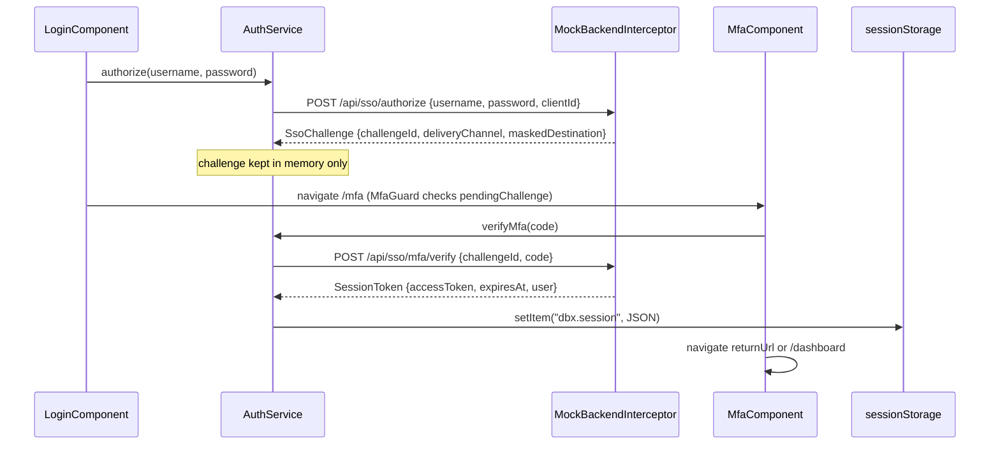

# Security

How sign-in, session handling, request headers and analytics redaction work in the digital-banking app, and which files are under AppSec review. Everything here runs against an in-browser mock backend, so the credentials and tokens are demo values with no real security value.

## Scope and caveats

- There is no real identity provider. `/api/sso/authorize` and `/api/sso/mfa/verify` are answered by `src/app/core/mock/mock-backend.interceptor.ts` (see [mock backend](systems/mock-backend.md)).
- The demo credentials are hard-coded and exported as `DEMO_CREDENTIALS` in `src/app/core/mock/mock-backend.interceptor.ts`: username `demo`, password `Demo@1234`, OTP `123456`. `src/app/features/auth/login.component.ts` imports them to show the hint on the login page.
- The access token is a mock string (`'mock.' + btoa(userId)`), valid for 15 minutes from the MFA response.
- Both `src/environments/environment.ts` and `src/environments/environment.prod.ts` set `useMockBackend: true`, so even a production build ships the mock gateway and the demo credentials.

Treat this page as a description of the client-side security design the repo models, not as evidence that the app is safe to expose to real users.

## Sign-in with MFA step-up

The flow is a two-step, OIDC-style authorize plus step-up MFA. The full user-facing flow is in [sign-in](features/sign-in.md).



Key behaviors, all in `src/app/core/auth/auth.service.ts`:

- `authorize()` posts to `${environment.ssoUrl}/authorize` with `clientId: environment.ssoClientId` (`digital-banking-web`) and stores the returned `SsoChallenge` in a private field. It is never written to storage, so a full page reload between `/login` and `/mfa` drops it. This is why routing uses hash URLs (see [pitfalls](background/pitfalls.md)).
- `verifyMfa()` sends the challenge id and code, clears the challenge, writes the `SessionToken` to `sessionStorage` under `dbx.session`, and pushes it into a `BehaviorSubject`.
- `token` returns the access token only while `expiresAt > Date.now()`. `isAuthenticated` is `token !== null`, so an expired session counts as signed out without any timer.
- On construction, `restore()` reads `dbx.session` from `sessionStorage`, discards it if expired or unparsable, and otherwise resumes the session. Nothing goes to `localStorage` or cookies, so closing the tab ends the session.
- `logout()` removes `dbx.session`, emits `null`, and navigates to `/login` unless called with `redirect = false`.

## Route guards

- `src/app/core/auth/auth.guard.ts`: `AuthGuard` implements `CanActivate` and `CanLoad`. When not authenticated it returns a `UrlTree` to `/login?returnUrl=<url>`. `src/app/app-routing.module.ts` applies it as both `canLoad` and `canActivate` on `dashboard`, `accounts`, `transfers` and `bill-pay`, so the lazy chunk is not even downloaded for signed-out users.
- `src/app/core/auth/mfa.guard.ts`: `MfaGuard` only allows `/mfa` while `AuthService.pendingChallenge` is set; otherwise it redirects to `/login`.

Guards run in the browser only. Any real deployment would need the API to enforce authorization independently.

## HTTP headers and 401 handling

The interceptor chain is described in [HTTP pipeline](systems/http-pipeline.md). The security-relevant parts:

- `src/app/core/http/auth.interceptor.ts` adds `X-Correlation-Id: dbx-<Date.now()>-<sequence>` to every request. It adds `Authorization: Bearer <token>` only when a valid token exists and the URL starts with `/api/` but not `/api/sso/`, so the token is never sent to SSO endpoints or to non-API URLs.
- `src/app/core/http/error.interceptor.ts` handles a 401 from any non-SSO URL by showing "Your session has expired. Please sign in again." and calling `AuthService.logout()`. A 401 from `/api/sso/*` (wrong password or OTP) is passed through to the component instead. Status 0 or 5xx shows a generic connectivity toast. The error is always rethrown.
- The mock backend returns 401 `unauthorized` for any non-SSO, non-analytics `/api/` request that lacks a `Bearer` header.

## Analytics PII redaction

`projects/analytics-sdk/src/lib/analytics.service.ts` scrubs event properties before they are queued. Any property whose key is in the redaction list is replaced with `'[REDACTED]'`. The default list is:

| Key |
|---|
| `accountNumber` |
| `ssn` |
| `routingNumber` |
| `cardNumber` |
| `password` |
| `otp` |

Apps can add keys through `redactFields` in `AnalyticsConfig` (`projects/analytics-sdk/src/lib/analytics.config.ts`); the digital-banking app does not add any (`src/app/app.module.ts`). Limits worth knowing, based on the code:

- Matching is by exact top-level key. Nested objects are not walked.
- Only `props` are scrubbed. The event `name` is not, and `page_view` names are the full `urlAfterRedirects` and `api_timing` names are `METHOD urlWithParams`. Account ids in routes such as `/accounts/:id` therefore reach the analytics payload.
- With `debug: !environment.production`, development builds log every event to the console.

More on the SDK is in [analytics SDK](packages/analytics-sdk.md).

## Display masking

`DbsMaskPipe` from `@dbs-demo/ui` (`projects/ui/src/lib/pipes/mask.pipe.ts`) masks account numbers in templates such as `src/app/features/transfers/transfer.component.html` and `src/app/features/bill-pay/bill-pay.component.html`. The full numbers are still present in the API responses and in memory. See [UI library](packages/ui.md).

## Security-reviewed code (SEC-2291, gate G3)

Every file in `src/app/core/auth/` and `src/app/core/http/` starts with:

```
// @security-reviewed SEC-2291 (2026-03-14, AppSec Consumer Apps). Behavior changes need a new review: docs/engineering/frontend-upgrade-policy.md (G3).
```

That covers `src/app/core/auth/auth.service.ts`, `src/app/core/auth/auth.guard.ts`, `src/app/core/auth/mfa.guard.ts`, `src/app/core/http/auth.interceptor.ts` and `src/app/core/http/error.interceptor.ts`. Under gate G3 of `docs/engineering/frontend-upgrade-policy.md`, only class A (mechanical, behavior-identical) changes are allowed without a new AppSec review, and the PR must call them out. Rewriting the class-based guards or interceptors as functional ones counts as beyond class A. See [upgrade gates](background/upgrade-gates.md).

## Ownership

`.github/CODEOWNERS` assigns `/src/app/core/auth/` and `/src/app/core/http/` to `@dbs-demo/appsec` and `@dbs-demo/digital-banking-core`. Its header comment says branch protection requires an approving review from the owning team. The mock backend in `src/app/core/mock/` is not under appsec ownership; it falls under the default `@dbs-demo/digital-banking-core`.

## Key source files

| File | Role |
|---|---|
| `src/app/core/auth/auth.service.ts` | SSO authorize, MFA verify, session storage, expiry, logout |
| `src/app/core/auth/auth.guard.ts` | `canLoad` / `canActivate` for protected routes |
| `src/app/core/auth/mfa.guard.ts` | Allows `/mfa` only with a pending challenge |
| `src/app/core/http/auth.interceptor.ts` | Bearer token and correlation id |
| `src/app/core/http/error.interceptor.ts` | 401 logout, 5xx / offline toast |
| `src/app/core/mock/mock-backend.interceptor.ts` | Demo credentials, mock token, 401 responses |
| `projects/analytics-sdk/src/lib/analytics.service.ts` | `scrub()` and default redaction keys |
| `.github/CODEOWNERS` | AppSec ownership of auth and http |
| `docs/engineering/frontend-upgrade-policy.md` | Gate G3 rules |
