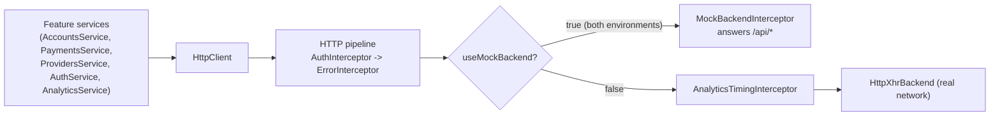

# Systems

These pages cover the cross-cutting runtime machinery in the `digital-banking` app that sits between the [features](../features/index.md) and the network. Both systems are wired in `src/app/core/core.module.ts` and `src/app/app.module.ts`.

Active contributors: Deepak Sekar

## Pages

| Page | What it covers |
|---|---|
| [HTTP pipeline](http-pipeline.md) | The ordered `HTTP_INTERCEPTORS` chain: bearer token and correlation id, 401 and 5xx handling, analytics timing beacons |
| [Mock backend](mock-backend.md) | `MockBackendInterceptor`, the in-browser stand-in for the API gateway, SSO and data providers, plus its seed data and toggle |

The REST contract that both systems implement or carry is documented in [API](../api.md).

## How they fit together

`CoreModule` throws "CoreModule is already loaded. Import it in AppModule only." if it is imported a second time, so the interceptor chain is registered exactly once. Both `src/environments/environment.ts` and `src/environments/environment.prod.ts` set `useMockBackend: true`, so every build of the app runs against the mock.

Related: [Digital banking app](../apps/digital-banking.md) for module wiring, [Security](../security.md) for the security-reviewed status of `src/app/core/http/*`.

## Key source files

| File | Purpose |
|---|---|
| `src/app/core/core.module.ts` | Registers `AuthInterceptor`, `ErrorInterceptor`, and conditionally `MockBackendInterceptor` |
| `src/app/app.module.ts` | Imports `CoreModule`, then `AnalyticsModule.forRoot()` which adds `AnalyticsTimingInterceptor` |
| `src/app/core/http/auth.interceptor.ts` | Headers |
| `src/app/core/http/error.interceptor.ts` | Error handling |
| `src/app/core/mock/mock-backend.interceptor.ts` | Mock routes |
| `src/environments/environment.ts` | `useMockBackend` flag |
