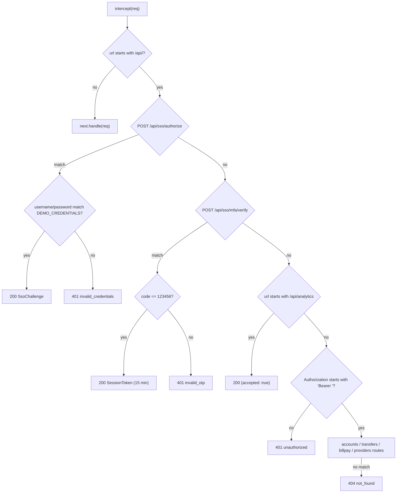

# Mock backend

`MockBackendInterceptor` is an Angular HTTP interceptor that answers every `/api/` request in the browser, standing in for the API gateway, Enterprise SSO and three third-party data providers. It is why `npm start` works with no server. State is held in memory and resets on a full page reload.

Active contributors: Deepak Sekar

## Purpose

Make the app fully self-contained for development, demos and the Angular upgrade exercise. The class comment in `src/app/core/mock/mock-backend.interceptor.ts` describes it as an "in-browser stand-in for the API gateway, Enterprise SSO and third-party data providers".

## Directory layout

```
src/app/core/mock/
  mock-backend.interceptor.ts   DEMO_CREDENTIALS, routing, transfer logic, helpers
  mock-data.ts                  MOCK_USER, MOCK_ACCOUNTS, buildTransactions(), MOCK_PAYEES
```

## Key abstractions

| Name | File | Role |
|---|---|---|
| `MockBackendInterceptor` | `src/app/core/mock/mock-backend.interceptor.ts` | `intercept()` passes non-`/api/` URLs to `next`; for `/api/` it calls `route(req)` and adds `delay(250)` |
| `DEMO_CREDENTIALS` | `src/app/core/mock/mock-backend.interceptor.ts` | `{ username: 'demo', password: 'Demo@1234', otp: '123456' }`. Also imported by `LoginComponent` to show the hint |
| `ok(body)` / `error(status, code)` | `src/app/core/mock/mock-backend.interceptor.ts` | Return `HttpResponse` with status 200, or `throwError` of a plain object `{ status, error: { error: code } }` |
| `confirm(status)` | `src/app/core/mock/mock-backend.interceptor.ts` | Builds `DBX` + `(100000 + counter)`, so the first confirmation is `DBX100001` |
| `MOCK_USER` | `src/app/core/mock/mock-data.ts` | Jordan Rivera, id `u-1001` |
| `MOCK_ACCOUNTS` | `src/app/core/mock/mock-data.ts` | Four accounts: `chk-01`, `sav-01`, `cc-01`, `inv-01` |
| `buildTransactions()` | `src/app/core/mock/mock-data.ts` | 18 transactions per account from a 12-merchant list, dated back from 2026-10-07 at 1.6-day steps |
| `MOCK_PAYEES` | `src/app/core/mock/mock-data.ts` | Four payees `p-1` to `p-4` |

## How it works

### Toggling

`src/app/core/core.module.ts` pushes `MockBackendInterceptor` onto the interceptor list only `if (environment.useMockBackend)`. Both `src/environments/environment.ts` and `src/environments/environment.prod.ts` set it to `true` (the prod file's comment says "Demo build: the mock gateway stays on so the app is fully self-contained"). To run against a real gateway you would set it to `false`; no real backend exists in this repository.

### Routing

`route()` is a sequence of `if` checks on exact URL and method. Order matters: SSO and analytics are checked before the auth check, so they work without a token.



All responses, including errors, are emitted after `delay(250)`.

The bearer check only tests the `Bearer ` prefix. The token value (`mock.` + `btoa('u-1001')`) is never validated, so expiry is enforced on the client by `AuthService.token`, not by the mock (see [HTTP pipeline](http-pipeline.md)).

### Authenticated routes

| Route | Behavior |
|---|---|
| `GET /api/accounts` | Returns the interceptor's working copy of the accounts |
| `GET /api/accounts/:id` | Regex `^/api/accounts/([\w-]+)$`. Returns the account or 404 `not_found` |
| `GET /api/accounts/:id/transactions` | Returns transactions filtered by `accountId`. Unknown ids return `[]`, not 404 |
| `POST /api/transfers` | 400 `invalid_accounts` if either account is missing or both are the same. 422 `insufficient_funds` if `amount <= 0` or `amount > from.available`. Otherwise moves the money, prepends two pending transactions, returns `status: 'completed'` |
| `GET /api/billpay/payees` | Returns `MOCK_PAYEES` |
| `POST /api/billpay/payments` | 422 `insufficient_funds` if the source is missing, `amount <= 0` or `amount > available`. Otherwise returns `status: 'scheduled'`. Balances are not changed |
| `/api/providers/credit-score` | Fixed score 782, band "Very Good", provider "FICO® Score 8 via TransUnion", as of 2026-10-01 |
| `/api/providers/market` | SPX, DJI, IXIC quotes |
| `/api/providers/aggregation` | Two external accounts: Wells Fargo Everyday Checking ••2291 and Fidelity 401(k) ••7710 |

The three provider routes match on URL only, so any HTTP method works. Full request and response shapes are in [API](../api.md).

### State

The interceptor is provided once by `CoreModule`, so it behaves as a singleton for the app's lifetime. In its constructor fields it copies `MOCK_ACCOUNTS` (shallow per account), builds the transaction list, and starts a confirmation counter at 0. Transfers mutate these copies, so balances and activity change during a session. A full reload rebuilds everything, which also means the [sign-in](../features/sign-in.md) session token in `sessionStorage` survives while mock balances do not.

### Seed accounts

| id | Name | Kind | Balance | Available |
|---|---|---|---|---|
| `chk-01` | Everyday Checking | checking | 8421.37 | 8121.37 |
| `sav-01` | Smart Saver Savings | savings | 25210.00 | 25210.00 |
| `cc-01` | Cashback Rewards Visa | credit | -1284.55 | 8715.45 |
| `inv-01` | Self-Directed Brokerage | investment | 61873.12 | 3100.00 |

Account and card numbers in the seed data are synthetic. The analytics SDK redacts keys like `accountNumber` and `routingNumber` if they appear in event props (see [Analytics SDK](../packages/analytics-sdk.md)).

## Integration points

- Sits third in the interceptor chain, after `AuthInterceptor` and `ErrorInterceptor`. Its errors flow back through `ErrorInterceptor`, which reads `err.status` from the plain error object. See [HTTP pipeline](http-pipeline.md).
- `LoginComponent` imports `DEMO_CREDENTIALS` directly from this file, so the demo hint always matches the mock.
- Every [feature](../features/index.md) reads its data from here when the mock is on.

## Entry points for modification

- Add an endpoint: add an `if` branch in `route()` in `src/app/core/mock/mock-backend.interceptor.ts`, before the final 404. Put it after the bearer check unless it must work without a session.
- Change seed data: `src/app/core/mock/mock-data.ts`.
- Change latency: the `delay(250)` in `intercept()`.
- Change credentials or OTP: `DEMO_CREDENTIALS`.
- Note that this file is not under `src/app/core/auth/` or `src/app/core/http/`, so it does not carry the SEC-2291 header.

## Key source files

| File | Purpose |
|---|---|
| `src/app/core/mock/mock-backend.interceptor.ts` | Mock routing, validation, state, credentials |
| `src/app/core/mock/mock-data.ts` | Seed user, accounts, transactions, payees |
| `src/app/core/core.module.ts` | Conditional registration |
| `src/environments/environment.ts` | `useMockBackend: true` (development) |
| `src/environments/environment.prod.ts` | `useMockBackend: true` (production build) |
| `src/app/core/models.ts` | Types the mock returns |
